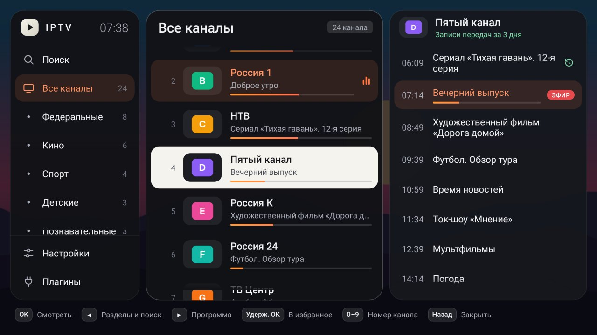
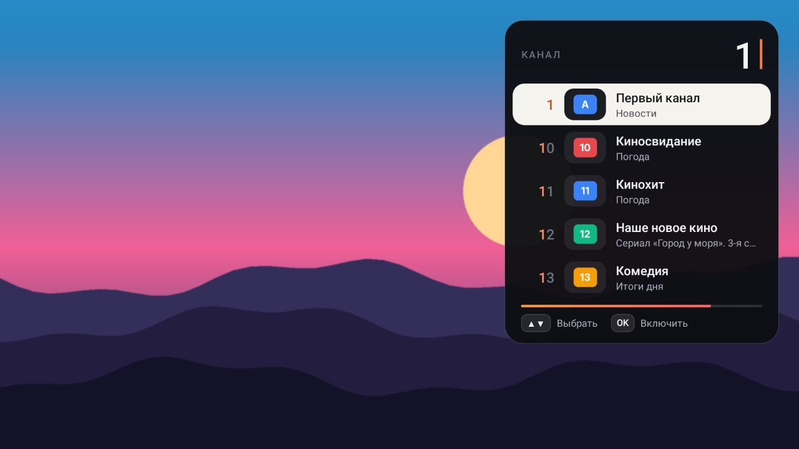
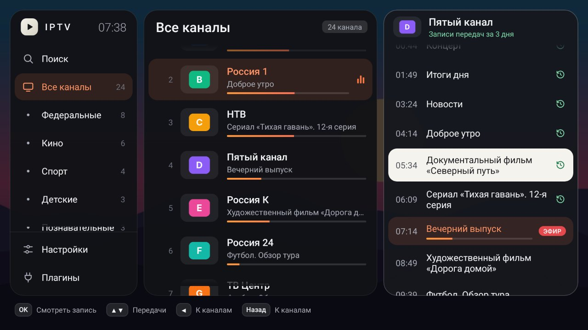
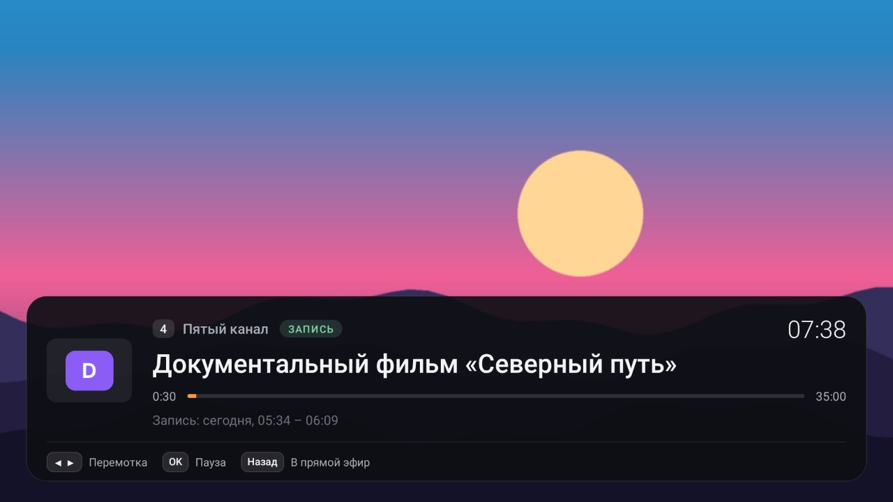
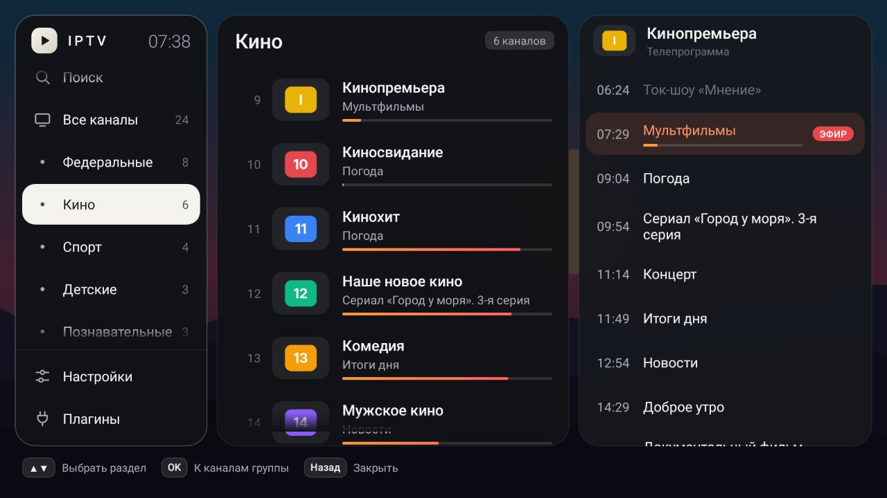
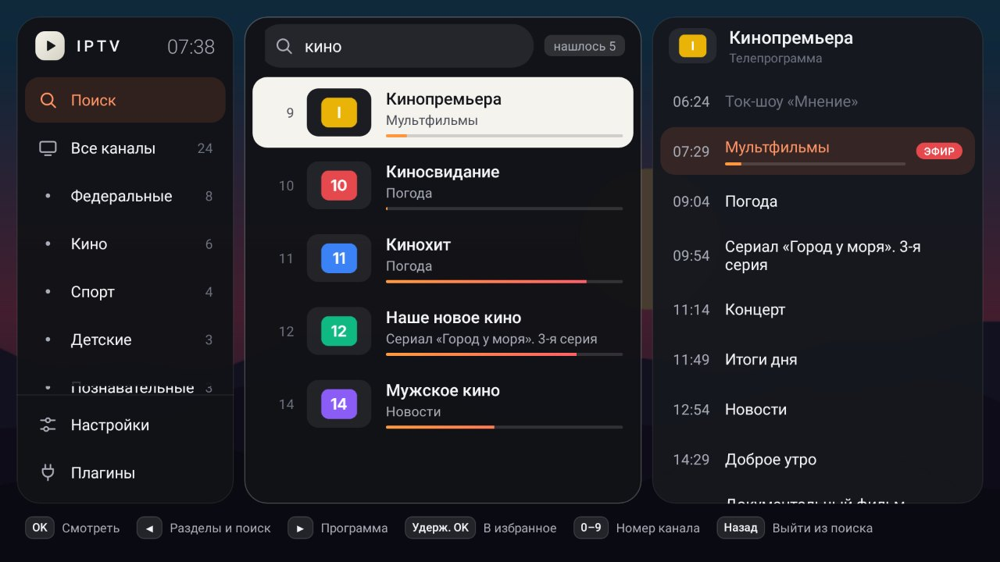
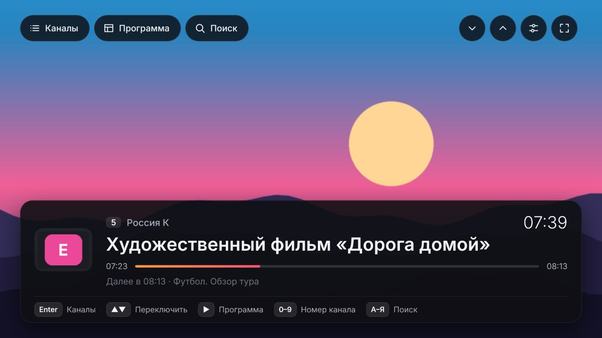
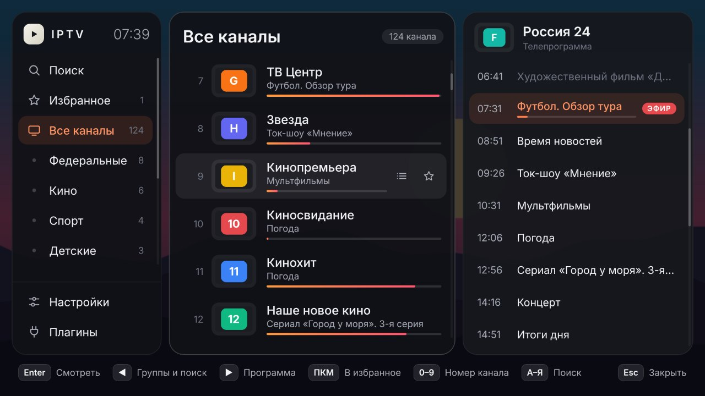
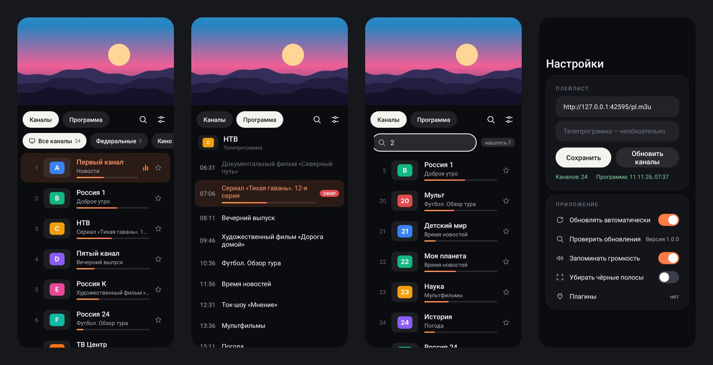

<div align="center">


# IPTV

**Простой плеер для IPTV-плейлистов.**
Вставляете ссылку на плейлист и смотрите — на телевизоре, телефоне и компьютере.

[](https://github.com/volnalabs/IPTV/releases/latest)
[](https://github.com/volnalabs/IPTV/actions)
[](https://github.com/volnalabs/IPTV/releases)
[](LICENSE)

[Скачать](#скачать) · [Установка](#установка) · [Управление](#управление) · [Плагины](#плагины) · [Вопросы](#вопросы-и-ответы)



</div>

## Что умеет

- **Всё на одном экране** — разделы, каналы и телепрограмма видны сразу, а внизу подсказано, какая кнопка что делает
- **Каналы по группам** — с логотипами и текущей передачей прямо в списке
- **Умный ввод номера** — нажали «1» и видите каналы 1, 10, 11, 12… с названием и логотипом; выбираете стрелками или просто ждёте
- **Телепрограмма** — на сегодня, вчера и завтра; берётся из плейлиста сама
- **Записи передач** — прошедшую передачу можно включить с начала, перемотать и поставить на паузу (если провайдер хранит записи)
- **Поиск** по названию или номеру канала и **избранное**
- **Запуск с последнего канала** — включили и сразу смотрите
- **Плагины** — свой файл `.js` с GitHub меняет список каналов или адреса потоков
- **Обновления** — на Android ставятся в пару нажатий, остальные версии сообщают о новой
- Ничего лишнего: ни рекламы, ни учётных записей, ни сбора данных

Все возможности есть во всех версиях. Плейлиста в приложении нет — нужна ссылка от вашего провайдера.

## Скачать

| Устройство | Файл |
|---|---|
| **Android TV / Google TV**, приставки, телефоны и планшеты Android 5.0+ | [`iptv.apk`](https://github.com/volnalabs/IPTV/releases/latest/download/iptv.apk) |
| **Телевизоры Samsung** (Tizen) | [`iptv-samsung.wgt`](https://github.com/volnalabs/IPTV/releases/latest/download/iptv-samsung.wgt) |
| **Телевизоры LG** (webOS) | [`iptv-lg.ipk`](https://github.com/volnalabs/IPTV/releases/latest/download/iptv-lg.ipk) |
| **Windows** 10 и 11 | [`iptv-windows.exe`](https://github.com/volnalabs/IPTV/releases/latest/download/iptv-windows.exe) |
| **macOS**, процессор Apple (M1 и новее) | [`iptv-mac-apple-silicon.dmg`](https://github.com/volnalabs/IPTV/releases/latest/download/iptv-mac-apple-silicon.dmg) |
| **macOS**, процессор Intel | [`iptv-mac-intel.dmg`](https://github.com/volnalabs/IPTV/releases/latest/download/iptv-mac-intel.dmg) |
| **Linux** | [`iptv-linux.AppImage`](https://github.com/volnalabs/IPTV/releases/latest/download/iptv-linux.AppImage) |

Ссылки всегда ведут на свежую версию. Все выпуски — на странице [релизов](https://github.com/volnalabs/IPTV/releases).

## Как это выглядит

<table>
<tr>
<td><br><sub>Эфир: что идёт сейчас, что дальше и какие кнопки что делают</sub></td>
<td><br><sub>Номер канала: набрали «1» — видно, какие каналы подходят</sub></td>
</tr>
<tr>
<td><br><sub>Телепрограмма канала и записи прошедших передач</sub></td>
<td><br><sub>Запись передачи: перемотка и пауза</sub></td>
</tr>
<tr>
<td><br><sub>Разделы: поиск, избранное, группы; настройки и плагины — внизу</sub></td>
<td><br><sub>Поиск по названию или номеру</sub></td>
</tr>
<tr>
<td><br><sub>Компьютер: подвигали мышью — появились кнопки</sub></td>
<td><br><sub>Компьютер: всё нажимается мышью, список листается колесом</sub></td>
</tr>
</table>

<div align="center">
<br>
<sub>Телефон: видео сверху, под ним вкладки «Каналы» и «Программа», группы в один ряд, поиск и настройки — значками. Повернёте телефон — видео развернётся на весь экран.</sub>
</div>

<sub>На скриншотах тестовые данные: вместо видео картинка, вместо логотипов цветные плашки. В приложении показываются логотипы из вашего плейлиста.</sub>

## Установка

### Android TV и приставки

**Прямо с телевизора**

1. Установите из Google Play приложение **Downloader**.
2. Введите в нём адрес `https://github.com/volnalabs/IPTV/releases/latest/download/iptv.apk`
3. Подтвердите установку. Если телевизор спросит про «неизвестные источники» — разрешите их для Downloader.

**С флешки**

1. Скачайте [`iptv.apk`](https://github.com/volnalabs/IPTV/releases/latest/download/iptv.apk) на компьютере и скопируйте на флешку.
2. Откройте файл на телевизоре в любом файловом менеджере и подтвердите установку.

При первом запуске откроются настройки. Ссылку на плейлист удобнее прислать с телефона: наведите камеру на QR-код на экране, вставьте ссылку на открывшейся странице и нажмите «Отправить на ТВ». Телефон и телевизор должны быть в одной сети Wi-Fi.

### Android: телефон и планшет

Скачайте [`iptv.apk`](https://github.com/volnalabs/IPTV/releases/latest/download/iptv.apk) прямо на телефоне, откройте файл и разрешите установку. Вставьте ссылку на плейлист и нажмите «Сохранить».

### Samsung

Телевизоры Samsung не ставят приложения с флешки. Приложение, которого нет в магазине, устанавливается с компьютера через режим разработчика. Это делается один раз и занимает 20–30 минут.

**Понадобится:** компьютер в одной сети с телевизором, бесплатная учётная запись Samsung и программа [Tizen Studio](https://developer.tizen.org/development/tizen-studio/download).

<details>
<summary><b>Пошаговая инструкция для Samsung</b></summary>

#### 1. Включите режим разработчика на телевизоре

1. Узнайте адрес компьютера в домашней сети (в Windows: команда `ipconfig`, строка «IPv4-адрес», обычно вида `192.168.1.10`).
2. На телевизоре откройте раздел **Apps** (Приложения).
3. Наберите на пульте **1 2 3 4 5**. Если на пульте нет цифр, нажмите кнопку **123** и наберите их на экране.
4. В появившемся окне включите **Developer mode** и впишите в поле **Host PC IP** адрес компьютера.
5. Выключите телевизор и включите снова (удерживайте кнопку питания на пульте, пока он не перезагрузится). В разделе Apps сверху появится надпись **Develop mode**.

#### 2. Установите Tizen Studio

1. Установите [Tizen Studio](https://developer.tizen.org/development/tizen-studio/download).
2. Откройте **Package Manager** (запускается после установки) и на вкладке **Extension SDK** установите **Samsung Certificate Extension** и **TV Extensions**.

#### 3. Подключите телевизор

1. Узнайте адрес телевизора: Настройки → Общие → Сеть → Состояние сети → Настройки IP.
2. В Tizen Studio откройте **Tools → Device Manager**, нажмите **Remote Device Manager** → **+**, впишите адрес телевизора (порт оставьте `26101`) и включите переключатель **Connection**.
3. Телевизор появится в списке устройств.

#### 4. Создайте сертификат

Телевизор принимает только приложения, подписанные сертификатом, в который вписан номер этого телевизора (DUID). Поэтому сначала подключают телевизор, а потом создают сертификат — тогда номер подставится сам.

1. **Tools → Certificate Manager** → **+**.
2. Выберите **Samsung** → **TV** → придумайте имя профиля.
3. Создайте новый сертификат автора (Author certificate): имя и пароль придумайте сами, затем войдите в учётную запись Samsung.
4. Создайте сертификат распространителя (Distributor certificate). В списке DUID должен стоять номер вашего телевизора.
5. В Device Manager щёлкните по телевизору правой кнопкой и выберите **Permit to install applications**.

#### 5. Подпишите и установите приложение

Скачайте [`iptv-samsung.wgt`](https://github.com/volnalabs/IPTV/releases/latest/download/iptv-samsung.wgt). Файл в релизе не подписан — его нужно подписать своим сертификатом.

Откройте терминал в папке с файлом. Программы `tizen` и `sdb` лежат в папках `tizen-studio/tools/ide/bin` и `tizen-studio/tools`.

```sh
# подписать своим сертификатом (вместо MyProfile — имя профиля из шага 4)
tizen package -t wgt -s MyProfile -- iptv-samsung.wgt

# посмотреть имя телевизора
sdb devices

# установить (вместо UE55XXXX — имя из предыдущей команды)
tizen install -n iptv-samsung.wgt -t UE55XXXX
```

Приложение **IPTV** появится в разделе Apps.

**Вариант без терминала.** В Tizen Studio: **File → Import → Tizen → Tizen Project**, укажите файл `iptv-samsung.wgt`, профиль **TV**. Затем щёлкните по проекту правой кнопкой: **Run As → Tizen Web Application**.

#### Если не получается

| Что происходит | Что проверить |
|---|---|
| Телевизор не подключается | Компьютер и телевизор в одной сети; в Host PC IP вписан адрес именно этого компьютера; телевизор перезагружен после включения режима; брандмауэр не блокирует порт 26101 |
| Ошибка сертификата при установке | Сертификат должен быть типа **Samsung**, а не Tizen, и в нём должен быть DUID этого телевизора. Создайте сертификат заново при подключённом телевизоре |
| Адрес в Host PC IP записывается задом наперёд | На некоторых прошивках с языком, где текст идёт справа налево, адрес нужно вводить в обратном порядке |

</details>

**Обновление.** Samsung не разрешает приложениям обновляться самим. Когда выйдет новая версия, приложение сообщит об этом; повторите шаг 5 с новым файлом. Каналы, избранное и плагины сохранятся.

### LG

Телевизоры LG тоже не ставят приложения с флешки. Нужен режим разработчика и компьютер в одной сети с телевизором. Первый раз это занимает 15–20 минут.

**Понадобится:** бесплатная учётная запись разработчика LG и [Node.js](https://nodejs.org/) на компьютере.

<details>
<summary><b>Пошаговая инструкция для LG</b></summary>

#### 1. Заведите учётную запись разработчика

Зарегистрируйтесь на [webostv.developer.lge.com](https://webostv.developer.lge.com/) и подтвердите почту. Обычная учётная запись LG не подойдёт — нужна именно запись разработчика (это бесплатно).

#### 2. Включите режим разработчика на телевизоре

1. Откройте магазин приложений LG (LG Content Store), найдите и установите приложение **Developer Mode**.
2. Запустите его и войдите с учётной записью из шага 1.
3. Включите **Dev Mode Status** — телевизор перезагрузится.
4. Снова откройте Developer Mode и включите **Key Server**. Запомните адрес телевизора (IP) и кодовую фразу (Passphrase) — они показаны на экране.

#### 3. Установите программу на компьютер

```sh
npm install -g @webos-tools/cli
```

#### 4. Подключите телевизор

```sh
ares-setup-device
```

Выберите **add** и ответьте на вопросы:

| Вопрос | Ответ |
|---|---|
| Device Name | `tv` |
| Device IP address | адрес телевизора с экрана Developer Mode |
| Device Port | `9922` |
| SSH user | `prisoner` |
| остальное | просто Enter |

Затем получите ключ. Команда спросит кодовую фразу — введите её в точности как на экране телевизора, с учётом больших и маленьких букв:

```sh
ares-novacom --device tv --getkey
```

Проверка связи (должны появиться сведения о телевизоре):

```sh
ares-device-info --device tv
```

#### 5. Установите приложение

Скачайте [`iptv-lg.ipk`](https://github.com/volnalabs/IPTV/releases/latest/download/iptv-lg.ipk) и выполните в папке с файлом:

```sh
ares-install --device tv iptv-lg.ipk
```

Приложение **IPTV** появится в списке приложений телевизора.

#### Важно: режим разработчика нужно продлевать

Режим разработчика на LG действует 1000 часов (около шести недель) с момента включения. Когда время истечёт, телевизор **удалит все приложения, поставленные через этот режим**. Чтобы этого не случилось, раз в месяц открывайте Developer Mode и нажимайте **EXTEND** — отсчёт начнётся заново. Оставшееся время видно в строке Remain Session.

Если приложение всё-таки удалилось: войдите в Developer Mode заново, включите Dev Mode Status и Key Server и повторите шаги 4 и 5. Ссылку на плейлист придётся ввести снова.

#### Если не получается

| Что происходит | Что проверить |
|---|---|
| `ares-novacom` не подключается | Key Server включён; компьютер и телевизор в одной сети; адрес и порт `9922` введены без ошибок |
| Не подходит кодовая фраза | Она чувствительна к регистру; после перезагрузки телевизора фраза может смениться |
| Режим разработчика выключается сам | С одной учётной записью режим работает только на одном телевизоре одновременно |

</details>

**Обновление.** Приложение сообщит о новой версии; скачайте новый `iptv-lg.ipk` и повторите шаг 5. Настройки сохранятся.

### Windows

Скачайте [`iptv-windows.exe`](https://github.com/volnalabs/IPTV/releases/latest/download/iptv-windows.exe) и запустите — установка не нужна. Файл не подписан платным сертификатом, поэтому Windows может показать окно «Система Windows защитила ваш компьютер»: нажмите **Подробнее → Выполнить в любом случае**.

### macOS

Скачайте файл под свой процессор (меню Apple → «Об этом Mac»: «Чип Apple» или «Процессор Intel»), откройте его и перетащите IPTV в «Программы».

Приложение не подписано сертификатом Apple, поэтому первый запуск macOS заблокирует. Откройте **Системные настройки → Конфиденциальность и безопасность**, прокрутите вниз и нажмите **«Всё равно открыть»** рядом с сообщением об IPTV. Если macOS пишет, что приложение повреждено, выполните в Терминале:

```sh
xattr -cr /Applications/IPTV.app
```

### Linux

```sh
chmod +x iptv-linux.AppImage
./iptv-linux.AppImage
```

Если не запускается на Ubuntu 22.04 и новее — установите библиотеку `libfuse2` (`sudo apt install libfuse2`).

## Управление

Запоминать ничего не нужно: внизу экрана всегда написано, что сейчас делают кнопки.

### Пульт и клавиатура

На компьютере пульт заменяют стрелки, Enter и Esc; F11 — на весь экран.

| Кнопка | Когда смотрите канал | В гиде (список каналов) |
|---|---|---|
| **ОК** | открыть гид: разделы, каналы и программа | включить канал или передачу |
| **▲ ▼** | следующий и предыдущий канал | листать |
| **◀ ▶** | ◀ — гид, ▶ — телепрограмма канала | перейти в соседнюю колонку: разделы ◀ каналы ▶ программа |
| **Цифры** | номер канала с подсказками | то же самое |
| **Удержать ОК** | | добавить канал в избранное или убрать |
| **Назад** | дважды — выход | закрыть |

**Номер канала.** Нажмите цифру — справа появятся каналы, чей номер с неё начинается: например, после «1» это 1, 10, 11, 12, 13. Дальше можно набрать вторую цифру, выбрать канал стрелками ▲▼ и нажать ОК или просто подождать пару секунд — включится выделенный. ◀ стирает цифру, «Назад» отменяет ввод.

**Разделы.** В левой колонке — «Поиск», «Избранное», «Все каналы» и группы из плейлиста; «Настройки» и «Плагины» закреплены внизу. Список идёт по кругу: с «Поиска» вверх — сразу к «Плагинам».

**Записи передач.** В телепрограмме прошедшие передачи со значком ⟲ можно посмотреть с начала. Во время просмотра ◀ ▶ перематывают на 30 секунд, ОК ставит на паузу, «Назад» возвращает прямой эфир.

**Цветные кнопки** (если они есть на пульте): красная — поиск, зелёная — избранное, жёлтая — телепрограмма, синяя — настройки.

### Мышь

Подвигайте мышью — поверх эфира появятся кнопки «Каналы», «Программа», «Поиск», переключение каналов, настройки и «на весь экран». В гиде всё нажимается: канал, передача, звёздочка избранного в строке канала, подсказки внизу. Колесо листает списки, правая кнопка добавляет канал в избранное. Чтобы найти канал, просто начните печатать его название.

### Телефон

Держите телефон вертикально — видео сверху, под ним вкладки «Каналы» и «Программа». Группы идут одним рядом над списком, поиск и настройки — значками справа. Звёздочка в строке добавляет канал в избранное. Поверните телефон горизонтально — видео развернётся на весь экран, касание покажет ту же карточку поверх видео.

## Плагины

Плагин — файл `.js`, который меняет список каналов или адрес потока: спрятать ненужные группы, отсортировать каналы, переименовать, дописать параметр к адресу. Один и тот же плагин работает во всех версиях приложения.

**Подключить:** гид → **Плагины** (внизу левой колонки; на телефоне — в настройках) → вставить ссылку на файл, например:

```
https://github.com/volnalabs/IPTV/blob/main/plugins/sort-by-name.js
```

**Написать свой** — несколько строк:

```js
IPTV.plugin({
  id: 'no-shops',
  name: 'Без телемагазинов',
  playlist: function (channels) {
    return channels.filter(function (c) { return c.group !== 'Телемагазины'; });
  }
});
```

Полное руководство — в [docs/PLUGINS.md](docs/PLUGINS.md), готовые примеры — в папке [plugins/](plugins).

> [!WARNING]
> Плагин видит весь список каналов и ссылки из вашего плейлиста. Ставьте только те плагины, авторам которых доверяете.

## Вопросы и ответы

**Какие плейлисты подходят?**
Формат M3U / M3U8 по ссылке `http://` или `https://`. Потоки — HLS (`.m3u8`); версия для Android включает и потоки MPEG-TS по прямой ссылке.

**Откуда берётся телепрограмма?**
Из ссылки в заголовке плейлиста (`url-tvg`). Если её там нет, ссылку на программу в формате XMLTV (`.xml` или `.xml.gz`) можно указать в настройках. Первая загрузка большой программы занимает до пары минут — каналы в это время уже можно смотреть.

**На моём старом телевизоре нет телепрограммы.**
Телепрограмме нужны возможности браузера, которые появились в телевизорах Samsung примерно с 2017 года и LG с 2018-го. На более старых моделях приложение работает без программы и записей; всё остальное доступно.

**Почему нет записей передач?**
Записи хранит провайдер. Они доступны, если в плейлисте у канала указан архив (`catchup`) и для канала есть телепрограмма.

**Как работают обновления?**
На Android приложение само скачивает новую версию и предлагает установить — нужно только подтвердить. На компьютерах оно сообщает о новой версии и открывает страницу загрузки. На Samsung и LG — сообщает, а файл ставится с компьютера. Проверку можно выключить в настройках.

**Приложение куда-то отправляет мои данные?**
Нет. Оно обращается только к вашему плейлисту, телепрограмме и логотипам каналов, а за обновлениями — к GitHub. Ссылка на плейлист хранится только на устройстве.

## Сборка из исходников

<details>
<summary>Для разработчиков</summary>

```
app/       приложение для Android (Kotlin, Media3)
web/       общая основа для компьютеров, Samsung и LG (JavaScript ES5)
shared/    среда выполнения плагинов — общая для всех версий
desktop/   оболочка Electron для Windows, macOS и Linux
samsung/   описание приложения Tizen
lg/        описание приложения webOS
plugins/   примеры плагинов
docs/      документация
```

```sh
# Android — нужен JDK 17
./gradlew :app:assembleRelease
./gradlew :app:testDebugUnitTest

# Samsung и LG
sh scripts/build-web.sh samsung build/samsung 1.0.0
sh scripts/build-web.sh lg build/lg 1.0.0

# Компьютер — нужен Node.js 22
sh scripts/build-web.sh desktop desktop/app 1.0.0
cd desktop && npm install && npx electron .
```

Каждое изменение в ветке `main` собирает все версии и выпускает релиз — см. [.github/workflows/build.yml](.github/workflows/build.yml).

</details>

## Лицензия

[MIT](LICENSE). В приложение входят [hls.js](https://github.com/video-dev/hls.js) (Apache 2.0) и [fflate](https://github.com/101arrowz/fflate) (MIT).
