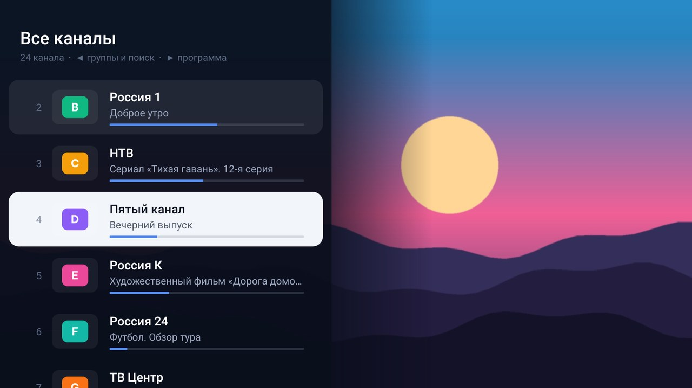
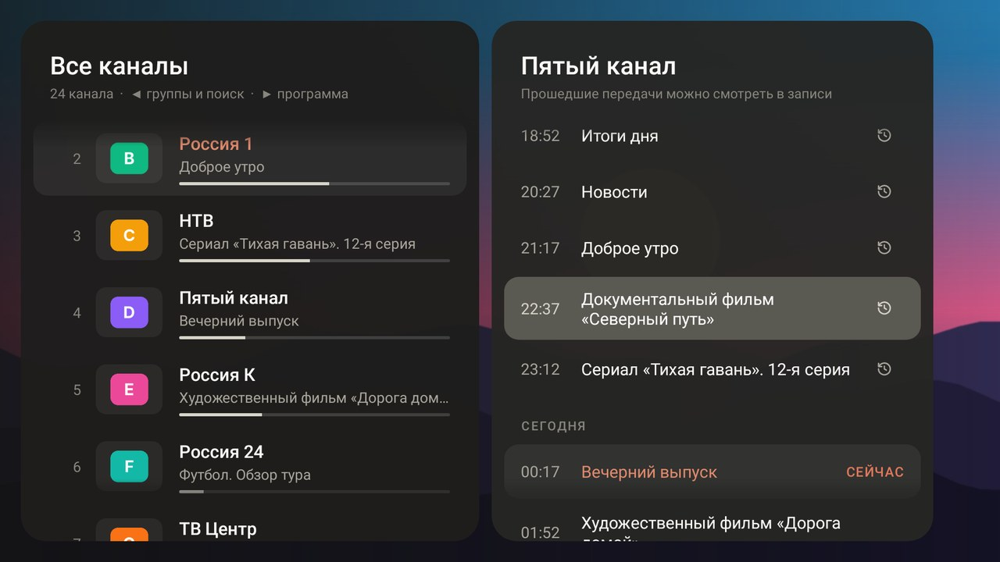
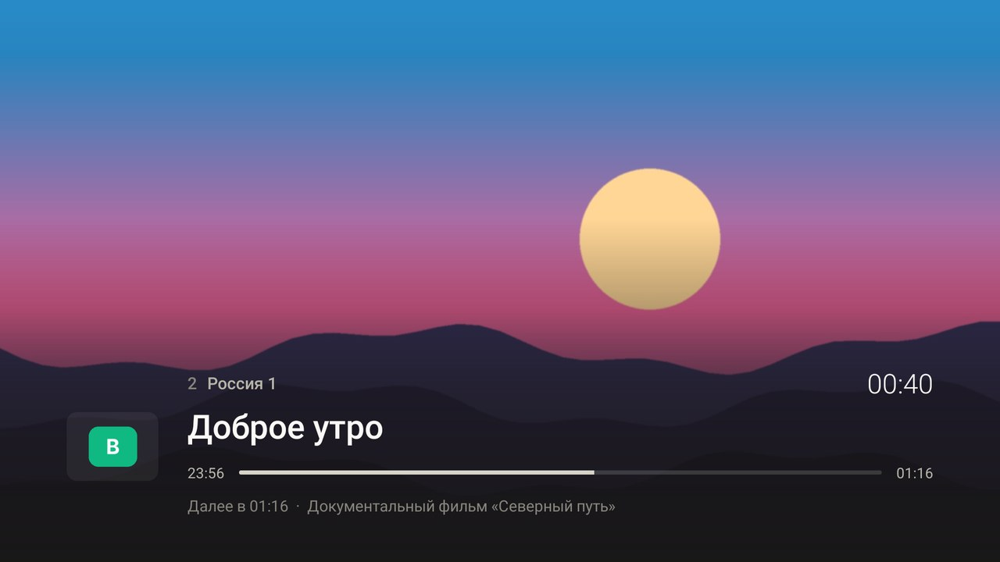
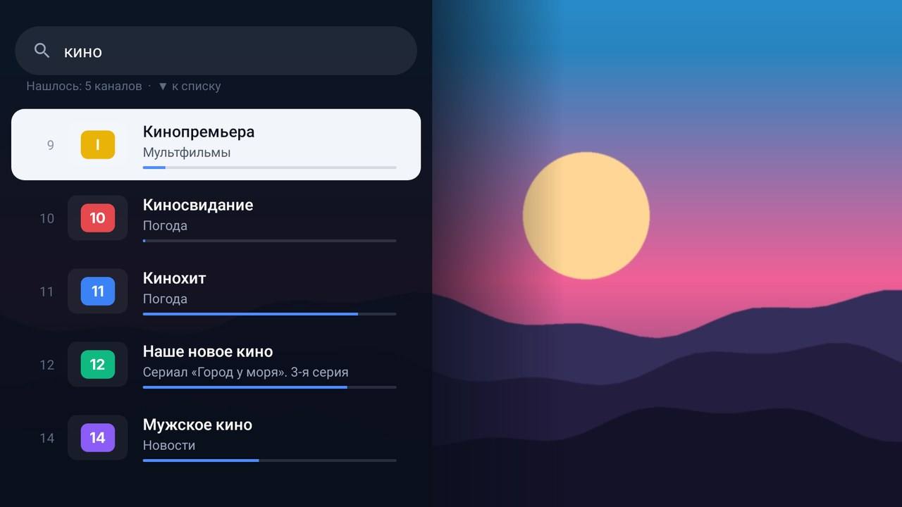
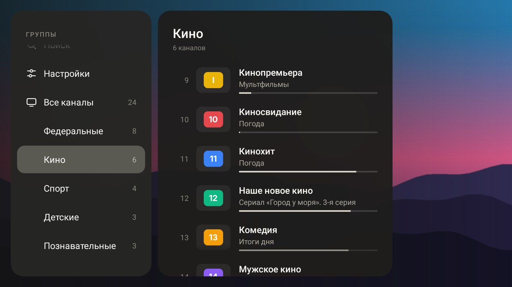
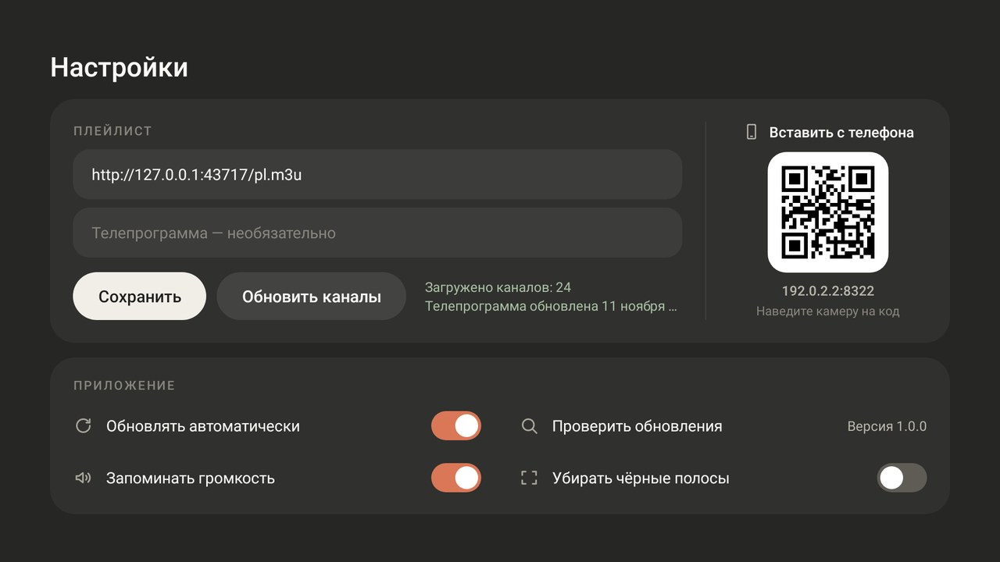

# IPTV

Простой IPTV-плеер для Android TV. Вставляете ссылку на плейлист и смотрите: каналы по группам, телепрограмма, записи передач, поиск и избранное. Всё управляется пультом. 

| | |
|---|---|
|  |  |
|  |  |
|  |  |

На скриншотах тестовые данные: вместо видео картинка-заглушка, вместо логотипов буквы. В приложении показываются логотипы из вашего плейлиста, а буква остаётся только у каналов без логотипа.

## Установка на телевизор

**Сразу с GitHub**
1. Установите на ТВ приложение **Downloader** (есть в Google Play).
2. Введите в нём ссылку:
   `https://github.com/volnalabs/IPTV/releases/latest/download/iptv.apk`
3. Подтвердите установку. Если ТВ спросит про «неизвестные источники», разрешите их для Downloader.

**С флешки**
1. Скачайте `iptv.apk` со страницы [релизов](https://github.com/volnalabs/IPTV/releases/latest) и скопируйте на флешку.
2. Откройте файл на ТВ через файловый менеджер и подтвердите установку.

## Первый запуск

Откроются настройки. Ссылку на плейлист удобнее вставить с телефона: наведите камеру на QR-код на экране ТВ, откроется страница, вставьте ссылку и нажмите «Отправить на ТВ». Телефон и телевизор должны быть в одной сети Wi-Fi.

Каналы появятся сразу, телепрограмма подгрузится в фоне (первый раз до минуты).

## Пульт

| Кнопка | Когда смотрите канал | В списке каналов |
|---|---|---|
| **ОК** | открыть список каналов | включить канал или передачу |
| **▲ ▼** | следующий / предыдущий канал | листать |
| **◀** | список каналов | меню: поиск, настройки, группы |
| **▶** | телепрограмма канала | телепрограмма выбранного канала |
| **Цифры** | включить канал по номеру | |
| **Удержать ОК** | | добавить канал в избранное |
| **Назад** | два раза — выход | закрыть список |

**Записи передач.** В телепрограмме прошедшие передачи со значком ⟲ можно посмотреть с начала: выберите передачу и нажмите ОК. Во время просмотра ◀ ▶ перематывают на 30 секунд, ОК ставит на паузу, «Назад» возвращает в прямой эфир.

**Поиск.** В списке каналов нажмите ◀ и выберите «Поиск». Начните вводить название, список сузится сам.

## Все версии

Файлы лежат на странице [релизов](https://github.com/volnalabs/IPTV/releases/latest).

| Устройство | Файл | Что умеет |
|---|---|---|
| Android TV, приставки, телефоны и планшеты Android | `iptv.apk` | всё: телепрограмма, записи, автообновление |
| Linux | `iptv-linux.AppImage` | облегчённая версия |
| Windows | `iptv-windows.exe` | облегчённая версия |
| macOS (Apple Silicon / Intel) | `iptv-mac-apple-silicon.dmg`, `iptv-mac-intel.dmg` | облегчённая версия |
| Телевизоры Samsung (Tizen) | `iptv-samsung.wgt` | облегчённая версия |
| Телевизоры LG (webOS) | `iptv-lg.ipk` | облегчённая версия |

**Облегчённая версия** — это общая веб-основа из папки `web/`: каналы по группам, логотипы, поиск, избранное, переключение цифрами, запуск с последнего канала. Телепрограммы, записей передач и автообновления в ней пока нет. Потоки поддерживаются в формате HLS (`.m3u8`).

### Телефон и планшет

Ставится тот же `iptv.apk`. Касание экрана открывает список каналов, кнопки «Меню» и «Программа» в его шапке открывают группы и телепрограмму, касание мимо карточек закрывает список. Долгое нажатие на канал добавляет его в избранное.

### Компьютер

- **Linux:** сделайте файл исполняемым (`chmod +x iptv-linux.AppImage`) и запустите.
- **Windows:** запустите `iptv-windows.exe`, установка не нужна. Файл не подписан, поэтому SmartScreen может предупредить: «Подробнее» → «Выполнить в любом случае».
- **macOS:** приложение не подписано сертификатом Apple. При первом запуске откройте его через правый щелчок → «Открыть»; если система говорит, что файл повреждён, выполните в терминале `xattr -cr /Applications/IPTV.app`.

Управление: стрелки и Enter, как на пульте, или мышь (щелчок по экрану открывает каналы, правый щелчок по каналу добавляет в избранное, колесо листает). F11 — на весь экран, Esc — назад.

### Samsung и LG

С флешки эти версии не ставятся: оба производителя принимают только приложения, установленные через режим разработчика.

- **Samsung:** поставьте на компьютер Tizen Studio с расширениями для ТВ, включите на телевизоре режим разработчика (раздел «Приложения») и укажите IP компьютера. В Tizen Studio создайте сертификат Samsung и запустите на телевизоре проект, собранный командой `sh scripts/build-web.sh samsung build/samsung`.
- **LG:** установите на телевизор приложение Developer Mode из магазина LG (нужна учётная запись разработчика LG), включите его и поставьте `iptv-lg.ipk` с компьютера через webOS CLI (`ares-install`) или webOS Dev Manager. Режим разработчика на LG нужно периодически продлевать, иначе приложение удалится.

Версия для Linux проверена запуском с настоящим HLS-потоком. Версии для Windows, macOS, Samsung и LG собраны, но на самих устройствах ещё не запускались.

## Обновления

Приложение само проверяет этот репозиторий и, когда выходит новая версия, скачивает её и предлагает установить. Подтвердить установку всё равно нужно кнопкой: Android не разрешает приложениям обновляться молча.

В настройках автообновление можно выключить ползунком или проверить обновления вручную.

## Что запоминается

При запуске включается канал, который вы смотрели последним, в той же группе. Приложение также возвращает громкость прошлого просмотра (отключается в настройках) и выбранный формат картинки. Если громкостью управляет сам телевизор или ресивер, он помнит её сам.

## Что поддерживается

- Плейлисты M3U/M3U8: `group-title`, `tvg-id`, `tvg-logo`, `#EXTGRP`, `#EXTVLCOPT` (User-Agent, Referer).
- Телепрограмма XMLTV, в том числе `.gz`. Ссылка берётся из `url-tvg` плейлиста или задаётся вручную.
- Архив: `catchup` = `shift`, `append`, `default`, `flussonic`, с `catchup-source`.
- Потоки HLS, MPEG-TS, DASH (плеер Media3 / ExoPlayer).
- Android 5.0 и новее: телевизоры, приставки, телефоны.

## Для разработки

```bash
./gradlew :app:assembleRelease     # app/build/outputs/apk/release/app-release.apk
./gradlew :app:testDebugUnitTest   # парсеры и сценарий работы с пультом
IPTV_SHOTS=docs/raw ./gradlew :app:testDebugUnitTest --tests '*ScreenshotTest*'   # скриншоты экранов
```

Каждый пуш в `main` собирает APK и выпускает релиз `v1.0.N` (N — номер сборки). По этому номеру установленные приложения понимают, что вышло обновление.

Веб-основа собирается под платформу скриптом `scripts/build-web.sh samsung|lg|desktop <папка>`; версия для компьютеров — Electron-проект в папке `desktop/`.

APK подписывается ключом `app/release.jks`, поэтому новые версии ставятся поверх старых. Ключ лежит в репозитории для простоты. Свой ключ задаётся переменными `IPTV_KEYSTORE`, `IPTV_KEYSTORE_PASSWORD`, `IPTV_KEY_ALIAS`, `IPTV_KEY_PASSWORD`.

Ссылку на свой плейлист в код не вшивайте: в ней обычно личный токен провайдера.
