<div align="center">

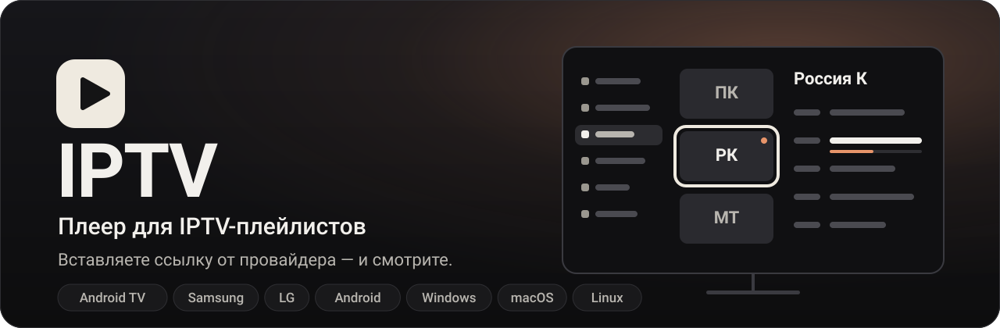

<br><br>

[](https://github.com/volnalabs/IPTV/releases/latest)
[](https://github.com/volnalabs/IPTV/actions)
[](https://github.com/volnalabs/IPTV/releases)
[](LICENSE)

**[Скачать](#download)** &nbsp;·&nbsp; **[Установка](#install)** &nbsp;·&nbsp; [Управление](#controls) &nbsp;·&nbsp; [Плагины](#plugins) &nbsp;·&nbsp; [Вопросы](#faq)

<br>

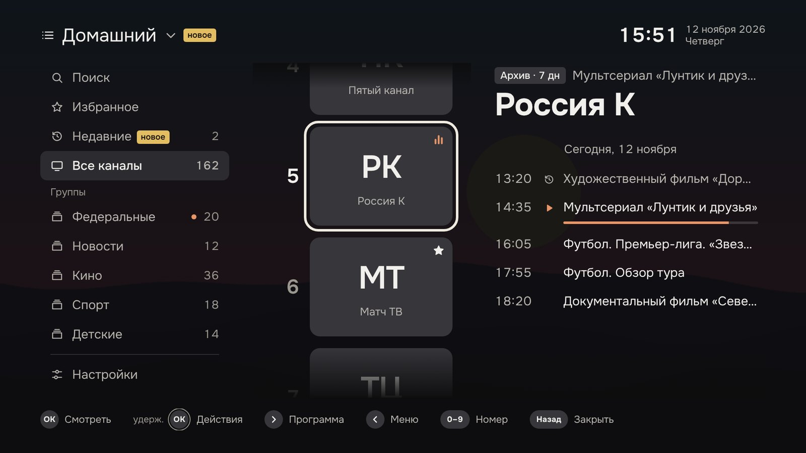

<sub>Гид на телевизоре: разделы слева, каналы посередине, программа справа. Наверху — сетка телепрограммы и настройки.</sub>

</div>

<p align="center"></p>

<a name="features"></a>

##  Возможности

<table>
<tr>
<td width="50%" valign="top">


**Гид на одном экране**<br>
Разделы, крупные плитки каналов и программа рядом. Внизу всегда подсказано, что делает каждая кнопка.

</td>
<td width="50%" valign="top">


**Быстрое переключение**<br>
▲▼ листают каналы, а поток включается, когда вы перестали нажимать, — без лишних загрузок.

</td>
</tr>
<tr>
<td width="50%" valign="top">


**Умный ввод номера**<br>
Нажали «1» — сразу видно каналы 1, 10, 11, 12 с названием и логотипом.

</td>
<td width="50%" valign="top">


**Телепрограмма и сетка**<br>
Программа на несколько дней, описание передачи и сетка «каналы × время».

</td>
</tr>
<tr>
<td width="50%" valign="top">


**Записи передач**<br>
Прошедшую передачу можно включить с начала и перемотать по шкале, как в YouTube.

</td>
<td width="50%" valign="top">


**Поиск по всему**<br>
Каналы, передачи, записи, группы и плейлисты — со своей экранной клавиатурой.

</td>
</tr>
<tr>
<td width="50%" valign="top">


**Несколько плейлистов**<br>
Домашний, спортивный, резервный — переключаются прямо в гиде.

</td>
<td width="50%" valign="top">


**Избранное за одно нажатие**<br>
Удержите OK на канале — и он в избранном. Недавние каналы всегда под рукой.

</td>
</tr>
<tr>
<td width="50%" valign="top">


**Плагины**<br>
Небольшой файл `.js` меняет список каналов или адреса потоков. Работает во всех версиях.

</td>
<td width="50%" valign="top">


**Обновляется само**<br>
Находит новую версию и ставит её по кнопке. Каналы и настройки сохраняются.

</td>
</tr>
</table>

> [!NOTE]
> Каналов в приложении нет — нужна ссылка на плейлист от вашего провайдера. Ни рекламы, ни учётных записей, ни сбора данных.

<p align="center"></p>

<a name="download"></a>

##  Скачать

<table>
<tr>
<td width="50%"><a href="https://github.com/volnalabs/IPTV/releases/latest/download/iptv.apk"></a></td>
<td width="50%"><a href="https://github.com/volnalabs/IPTV/releases/latest/download/iptv-samsung.wgt"></a></td>
</tr>
<tr>
<td width="50%"><a href="https://github.com/volnalabs/IPTV/releases/latest/download/iptv-lg.ipk"></a></td>
<td width="50%"><a href="https://github.com/volnalabs/IPTV/releases/latest/download/iptv-windows.exe"></a></td>
</tr>
<tr>
<td width="50%"><a href="https://github.com/volnalabs/IPTV/releases/latest/download/iptv-mac-apple-silicon.dmg"></a></td>
<td width="50%"><a href="https://github.com/volnalabs/IPTV/releases/latest/download/iptv-mac-intel.dmg"></a></td>
</tr>
<tr>
<td width="50%"><a href="https://github.com/volnalabs/IPTV/releases/latest/download/iptv-linux.AppImage"></a></td>
<td width="50%"><a href="https://github.com/volnalabs/IPTV/releases">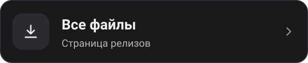</a></td>
</tr>
</table>

Ссылки всегда ведут на свежую версию. Не знаете, что ставить, — смотрите [установку](#install).

<p align="center"></p>

<a name="look"></a>

##  Как это выглядит

### На телевизоре

<table>
<tr>
<td width="50%"><br><sub><b>Эфир.</b> Что идёт сейчас. ◀ — список каналов, ▶ — программа</sub></td>
<td width="50%"><br><sub><b>Программа канала.</b> Прошедшие передачи со значком ⟲ можно смотреть в записи</sub></td>
</tr>
<tr>
<td>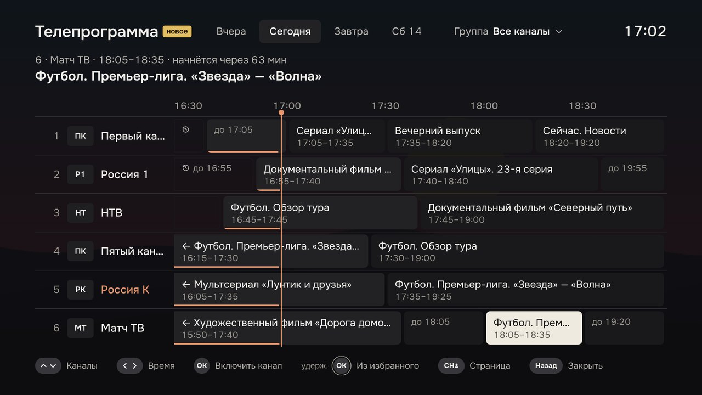<br><sub><b>Сетка «каналы × время».</b> Видно, что идёт на соседних каналах</sub></td>
<td><br><sub><b>Номер канала.</b> Набрали «1» — видно, какие каналы подходят</sub></td>
</tr>
<tr>
<td><br><sub><b>Поиск.</b> Своя экранная клавиатура; каналы, передачи и записи по разделам</sub></td>
<td><br><sub><b>Запись передачи.</b> Шкала с перемоткой как в YouTube: ◀ ▶ двигают метку, время видно над ней</sub></td>
</tr>
<tr>
<td>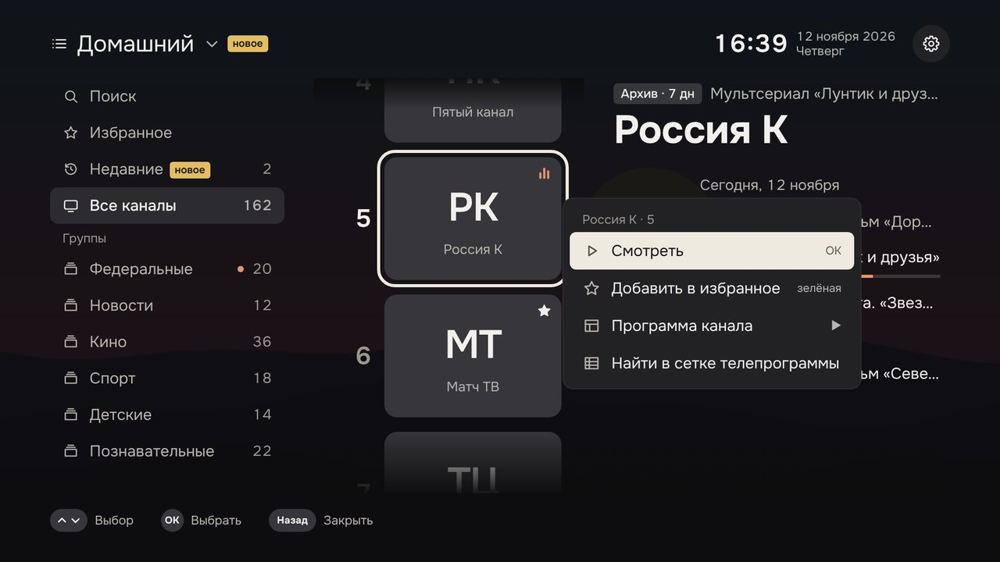<br><sub><b>Удержите OK.</b> Канал сразу в избранном — без лишних меню</sub></td>
<td>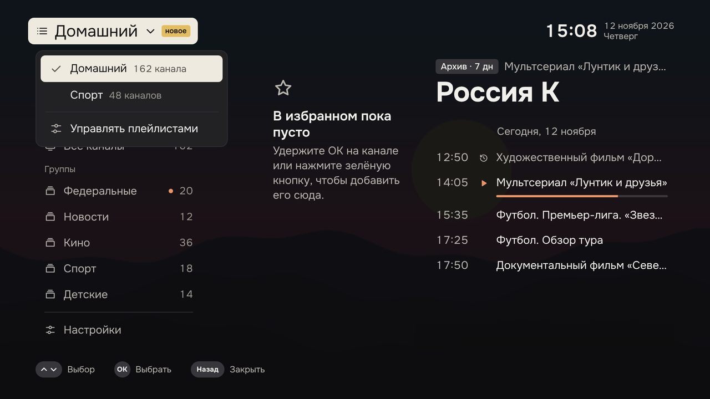<br><sub><b>Плейлисты.</b> Переключаются прямо в гиде</sub></td>
</tr>
<tr>
<td>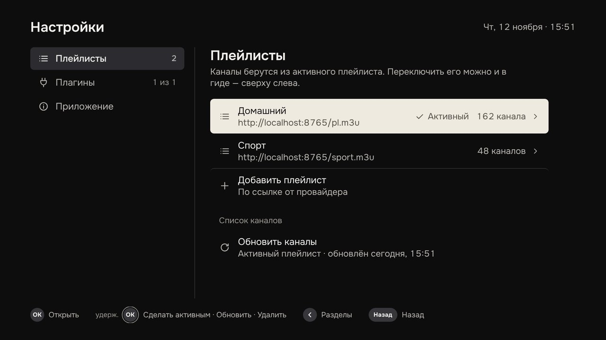<br><sub><b>Настройки.</b> Плейлисты, плагины, обновления; на Android TV рядом QR-код для телефона</sub></td>
<td>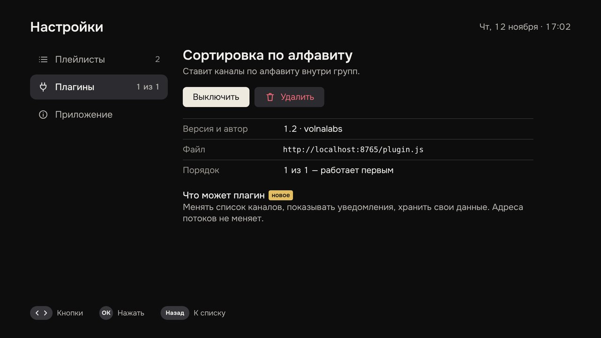<br><sub><b>Плагины.</b> Что плагин умеет, порядок, включение и удаление</sub></td>
</tr>
</table>

### На компьютере

<table>
<tr>
<td width="50%">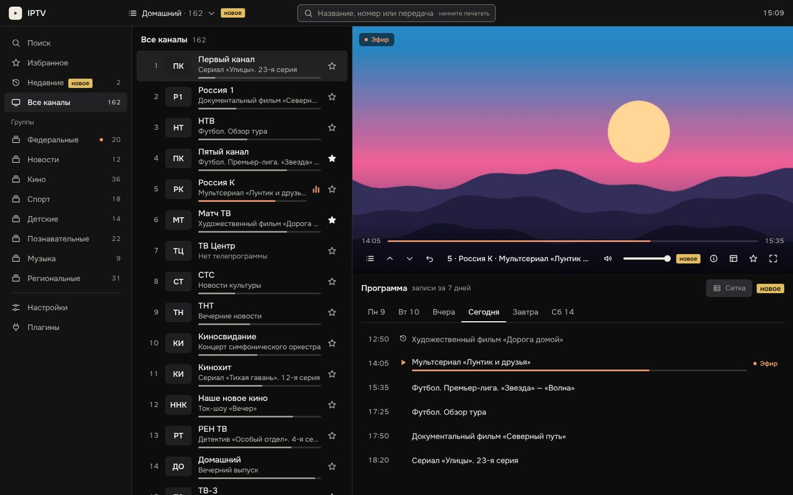<br><sub><b>Окно.</b> Разделы, список каналов и плеер с программой под ним</sub></td>
<td width="50%">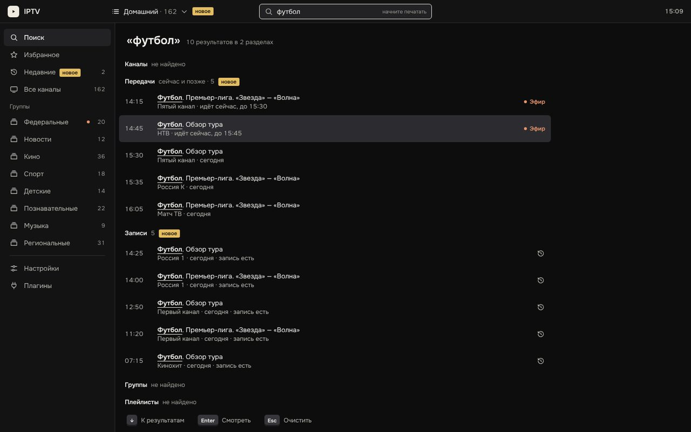<br><sub><b>Поиск.</b> Просто начните печатать</sub></td>
</tr>
</table>

### На телефоне и планшете

<div align="center">
<br>
<sub>Видео сверху, под ним вкладки «Каналы» и «Программа». Повернёте телефон — видео развернётся на весь экран.</sub>
<br><br>
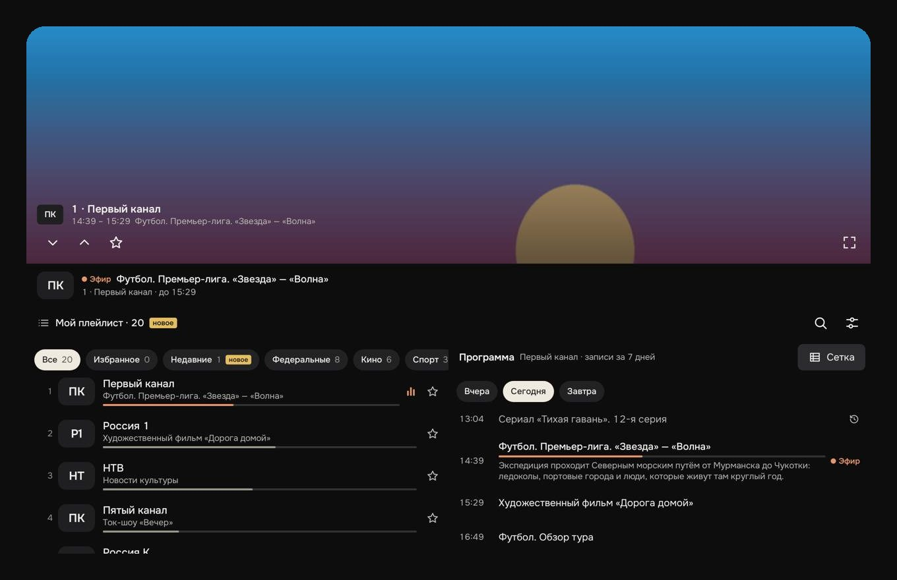<br>
<sub>На большом планшете список каналов и программа стоят рядом.</sub>
</div>

<sub>На скриншотах тестовые данные: вместо видео — картинка, вместо логотипов — буквы. В приложении показываются логотипы из вашего плейлиста.</sub>

<p align="center"></p>

<a name="install"></a>

##  Установка

Выберите устройство — откроется инструкция.

<table>
<tr>
<td width="50%"><a href="#android-tv">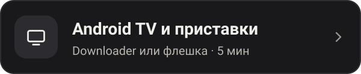</a></td>
<td width="50%"><a href="#android">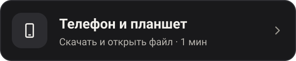</a></td>
</tr>
<tr>
<td width="50%"><a href="#samsung">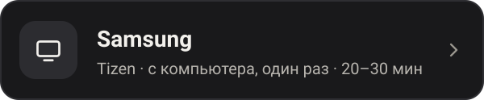</a></td>
<td width="50%"><a href="#lg">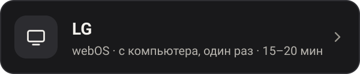</a></td>
</tr>
<tr>
<td width="50%"><a href="#windows">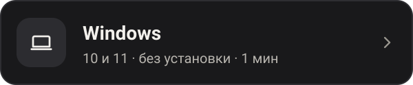</a></td>
<td width="50%"><a href="#macos">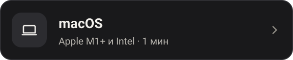</a></td>
</tr>
<tr>
<td width="50%"><a href="#linux">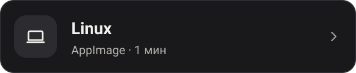</a></td>
<td width="50%"><a href="#download"></a></td>
</tr>
</table>

<a name="android-tv"></a>

### Android TV и приставки

<table><tr><td>

**Вариант 1 — прямо с телевизора.** Установите из Google Play приложение **Downloader**, введите в нём адрес и подтвердите установку:

```
https://github.com/volnalabs/IPTV/releases/latest/download/iptv.apk
```

Если телевизор спросит про «неизвестные источники» — разрешите их для Downloader.

**Вариант 2 — с флешки.** Скачайте [`iptv.apk`](https://github.com/volnalabs/IPTV/releases/latest/download/iptv.apk) на компьютере, скопируйте на флешку и откройте файл на телевизоре в любом файловом менеджере.

</td></tr></table>

> [!TIP]
> **Ссылку на плейлист не нужно набирать пультом.** На экране первого запуска и в настройках есть QR-код: наведите на него камеру телефона, вставьте ссылку на открывшейся странице и нажмите «Отправить на ТВ». Телефон и телевизор должны быть в одной сети Wi-Fi.

<sub><a href="#install">↑ к выбору устройства</a></sub>

<a name="android"></a>

### Телефон и планшет на Android

1. Скачайте [`iptv.apk`](https://github.com/volnalabs/IPTV/releases/latest/download/iptv.apk) прямо на телефоне.
2. Откройте файл и разрешите установку.
3. Вставьте ссылку на плейлист и нажмите **«Открыть»**.

<sub><a href="#install">↑ к выбору устройства</a></sub>

<a name="samsung"></a>

### Samsung (Tizen)

Телевизоры Samsung не ставят приложения с флешки. Приложение, которого нет в магазине, устанавливается с компьютера через режим разработчика.

> [!IMPORTANT]
> **Понадобится:** компьютер в одной сети с телевизором, бесплатная учётная запись Samsung и программа [Tizen Studio](https://download.tizen.org/sdk/Installer/Latest/).

####  Режим разработчика на телевизоре

1. Узнайте адрес компьютера в домашней сети. В Windows — команда `ipconfig`, строка «IPv4-адрес», обычно вида `192.168.1.10`.
2. На телевизоре откройте раздел **Apps** (Приложения).
3. Наберите на пульте **1 2 3 4 5**. Если на пульте нет цифр, нажмите кнопку **123** и наберите их на экране.
4. Включите **Developer mode** и впишите в поле **Host PC IP** адрес компьютера.
5. Перезагрузите телевизор: удерживайте кнопку питания на пульте, пока он не выключится и не включится снова. В разделе Apps появится надпись **Develop mode**.

####  Tizen Studio

1. Скачайте Tizen Studio для своей операционной системы:

   | Операционная система | Скачать |
   |:--|:--|
   | **Windows (64-bit)** | [Скачать `.exe`](https://download.tizen.org/sdk/Installer/Latest/Baseline_Tizen_Studio_windows-64.exe) |
   | **macOS (64-bit)** | [Скачать `.dmg`](https://download.tizen.org/sdk/Installer/Latest/Baseline_Tizen_Studio_macos-64.dmg) |
   | **Linux / Ubuntu (64-bit)** | [Скачать `.bin`](https://download.tizen.org/sdk/Installer/Latest/Baseline_Tizen_Studio_ubuntu-64.bin) |

   Все версии также доступны в [официальном каталоге Tizen Studio Latest](https://download.tizen.org/sdk/Installer/Latest/).

2. Запустите скачанный установщик и завершите установку.
3. Откройте **Package Manager** — он запустится после установки.
4. На вкладке **Extension SDK** установите:
   - **TV Extensions** — установите последнюю доступную версию расширения для разработки приложений Samsung Smart TV (например, TV Extensions-10.0 или новее).
   - **Samsung Certificate Extension** — расширение для создания сертификатов, необходимых для установки приложения на телевизор.

####  Подключение телевизора

1. Узнайте адрес телевизора: Настройки → Общие → Сеть → Состояние сети → Настройки IP.
2. В Tizen Studio откройте **Tools → Device Manager** → **Remote Device Manager** → **+**.
3. Впишите адрес телевизора, порт оставьте `26101` и включите **Connection**. Телевизор появится в списке устройств.

####  Сертификат

> [!NOTE]
> Телевизор принимает только приложения, подписанные сертификатом с номером именно этого телевизора (DUID). Поэтому сначала подключают телевизор, а потом создают сертификат — тогда номер подставится сам.

1. **Tools → Certificate Manager** → **+**.
2. Выберите **Samsung** → **TV** и придумайте имя профиля.
3. Создайте сертификат автора (Author certificate): имя и пароль придумайте сами, затем войдите в учётную запись Samsung.
4. Создайте сертификат распространителя (Distributor certificate). В списке DUID должен стоять номер вашего телевизора.
5. В Device Manager щёлкните по телевизору правой кнопкой → **Permit to install applications**.

####  Установка

Скачайте [`iptv-samsung.wgt`](https://github.com/volnalabs/IPTV/releases/latest/download/iptv-samsung.wgt). Файл в релизе не подписан — его нужно подписать своим сертификатом. Откройте терминал в папке с файлом; программы `tizen` и `sdb` лежат в `tizen-studio/tools/ide/bin` и `tizen-studio/tools`.

```sh
# подписать своим сертификатом (вместо MyProfile — имя профиля из шага 4)
tizen package -t wgt -s MyProfile -- iptv-samsung.wgt

# узнать имя телевизора
sdb devices

# установить (вместо UE55XXXX — имя из предыдущей команды)
tizen install -n iptv-samsung.wgt -t UE55XXXX
```

Готово — приложение **IPTV** появится в разделе Apps.

> [!TIP]
> **Без терминала:** в Tizen Studio выберите **File → Import → Tizen → Tizen Project**, укажите `iptv-samsung.wgt` и профиль **TV**, затем щёлкните по проекту правой кнопкой → **Run As → Tizen Web Application**.

<details>
<summary><b>Если не получается</b></summary>

<br>

| Что происходит | Что проверить |
|---|---|
| Телевизор не подключается | Компьютер и телевизор в одной сети · в Host PC IP адрес именно этого компьютера · телевизор перезагружен после включения режима · брандмауэр не блокирует порт 26101 |
| Ошибка сертификата | Сертификат должен быть типа **Samsung**, а не Tizen, и с DUID этого телевизора. Создайте его заново при подключённом телевизоре |
| Адрес в Host PC IP записывается задом наперёд | На некоторых прошивках с языком справа налево адрес нужно вводить в обратном порядке |

</details>

#### Обновления

Повторять установку не нужно: когда выйдет новая версия, приложение предложит обновиться и по кнопке **«Обновить»** поставит её само. Каналы, избранное и плагины сохранятся. Изредка обновление меняет сам пакет — тогда приложение скажет об этом, и нужно будет повторить шаг 5 с новым файлом.

<sub><a href="#install">↑ к выбору устройства</a></sub>

<a name="lg"></a>

### LG (webOS)

Телевизоры LG тоже не ставят приложения с флешки. Нужен режим разработчика и компьютер в одной сети с телевизором.

> [!IMPORTANT]
> **Понадобится:** бесплатная учётная запись **разработчика** LG и [Node.js](https://nodejs.org/) на компьютере.

####  Учётная запись разработчика

Зарегистрируйтесь на [webostv.developer.lge.com](https://webostv.developer.lge.com/) и подтвердите почту. Обычная учётная запись LG не подойдёт — нужна именно запись разработчика (это бесплатно).

####  Режим разработчика на телевизоре

1. В магазине LG Content Store найдите и установите приложение **Developer Mode**.
2. Запустите его и войдите с учётной записью из шага 1.
3. Включите **Dev Mode Status** — телевизор перезагрузится.
4. Снова откройте Developer Mode и включите **Key Server**. Запишите адрес телевизора (IP) и кодовую фразу (Passphrase) с экрана.

####  Программа на компьютере

```sh
npm install -g @webos-tools/cli
```

####  Подключение телевизора

```sh
ares-setup-device
```

Выберите **add** и ответьте на вопросы:

| Вопрос | Ответ |
|---|---|
| Device Name | `tv` |
| Device IP address | адрес с экрана Developer Mode |
| Device Port | `9922` |
| SSH user | `prisoner` |
| остальное | просто Enter |

Получите ключ — команда спросит кодовую фразу. Вводите в точности как на экране, с большими и маленькими буквами:

```sh
ares-novacom --device tv --getkey
```

Проверьте связь — должны появиться сведения о телевизоре:

```sh
ares-device-info --device tv
```

####  Установка

Скачайте [`iptv-lg.ipk`](https://github.com/volnalabs/IPTV/releases/latest/download/iptv-lg.ipk) и выполните в папке с файлом:

```sh
ares-install --device tv iptv-lg.ipk
```

Готово — приложение **IPTV** появится в списке приложений телевизора.

> [!WARNING]
> **Режим разработчика нужно продлевать.** Он действует 1000 часов (около шести недель). Когда время истечёт, телевизор **удалит все приложения, поставленные через этот режим**. Раз в месяц открывайте Developer Mode и нажимайте **EXTEND** — оставшееся время видно в строке Remain Session.
>
> Если приложение всё-таки удалилось: войдите в Developer Mode, включите Dev Mode Status и Key Server и повторите шаги 4 и 5. Ссылку на плейлист придётся ввести снова.

<details>
<summary><b>Если не получается</b></summary>

<br>

| Что происходит | Что проверить |
|---|---|
| `ares-novacom` не подключается | Key Server включён · компьютер и телевизор в одной сети · адрес и порт `9922` без ошибок |
| Не подходит кодовая фраза | Она чувствительна к регистру; после перезагрузки телевизора может смениться |
| Режим разработчика выключается сам | С одной учётной записью режим работает только на одном телевизоре одновременно |

</details>

#### Обновления

Повторять установку не нужно: когда выйдет новая версия, приложение предложит обновиться и по кнопке **«Обновить»** поставит её само. Настройки сохранятся. Изредка обновление меняет сам пакет — тогда нужно будет скачать новый `iptv-lg.ipk` и повторить шаг 5.

<sub><a href="#install">↑ к выбору устройства</a></sub>

<a name="windows"></a>

### Windows

Скачайте [`iptv-windows.exe`](https://github.com/volnalabs/IPTV/releases/latest/download/iptv-windows.exe) и запустите — установка не нужна.

> [!NOTE]
> Файл не подписан платным сертификатом, поэтому Windows может показать окно «Система Windows защитила ваш компьютер». Нажмите **Подробнее → Выполнить в любом случае**.

<sub><a href="#install">↑ к выбору устройства</a></sub>

<a name="macos"></a>

### macOS

1. Скачайте файл под свой процессор: меню Apple → «Об этом Mac» — [Apple M1 и новее](https://github.com/volnalabs/IPTV/releases/latest/download/iptv-mac-apple-silicon.dmg) или [Intel](https://github.com/volnalabs/IPTV/releases/latest/download/iptv-mac-intel.dmg).
2. Откройте его и перетащите IPTV в «Программы».
3. Первый запуск macOS заблокирует, потому что приложение не подписано сертификатом Apple. Откройте **Системные настройки → Конфиденциальность и безопасность**, прокрутите вниз и нажмите **«Всё равно открыть»** рядом с сообщением об IPTV.

Если macOS пишет, что приложение повреждено, выполните в Терминале:

```sh
xattr -cr /Applications/IPTV.app
```

<sub><a href="#install">↑ к выбору устройства</a></sub>

<a name="linux"></a>

### Linux

```sh
chmod +x iptv-linux.AppImage
./iptv-linux.AppImage
```

Если не запускается на Ubuntu 22.04 и новее — установите `libfuse2`:

```sh
sudo apt install libfuse2
```

<sub><a href="#install">↑ к выбору устройства</a></sub>

<p align="center"></p>

<a name="controls"></a>

##  Управление

Запоминать ничего не нужно: внизу экрана всегда написано, что сейчас делают кнопки.

### Пульт

| Кнопка | Когда смотрите канал | В гиде |
|:-:|---|---|
| **OK** | гид: разделы, каналы и что на них идёт | включить канал или передачу |
| **▲ ▼** | листать каналы — поток включится, когда перестанете нажимать | листать |
| **◀ ▶** | ◀ — гид со списком каналов, ▶ — программа канала (стрелки видны рядом с названием канала) | соседняя колонка: разделы ◀ каналы ▶ программа |
| **0–9** | номер канала с подсказками | то же |
| **удержать OK** | канал в избранное или из него | то же |
| **Назад** | дважды — выход | закрыть |

**Цветные кнопки:** 🔴 поиск · 🟢 избранное · 🟡 программа канала · 🔵 настройки.

<details>
<summary><b>Номер канала, разделы и записи — подробнее</b></summary>

<br>

**Номер канала.** Нажмите цифру — справа появятся каналы, чей номер с неё начинается: после «1» это 1, 10, 11, 12. Наберите вторую цифру или выберите канал ▲▼ и нажмите OK — или просто подождите пару секунд. ◀ стирает цифру, «Назад» отменяет ввод.

**Разделы.** Слева — «Поиск», «Избранное», «Недавние», «Все каналы» и группы из плейлиста. «Настройки» — круглая кнопка с шестерёнкой справа от часов: ▲ с «Поиска» ведёт в шапку, там же выбор плейлиста, если их несколько.

**Записи передач.** Прошедшие передачи со значком ⟲ можно посмотреть с начала. ◀ ▶ открывают шкалу и двигают метку — чем дольше держите, тем больше шаг, время видно над меткой; через секунду запись перейдёт туда (или сразу по OK). ▼ — кнопки «−30 с», «Пауза», «+30 с» и «Вернуться в эфир». OK — пауза, «Назад» — прямой эфир.

**Поиск.** Красная кнопка открывает поиск со своей экранной клавиатурой — системная клавиатура телевизора не нужна. Цифры на пульте ищут по номеру канала, ▶ с края клавиатуры — к результатам.

</details>

### Клавиатура и мышь

| Клавиша | Действие |
|:-:|---|
| `↑` `↓` | канал в плеере, строка в списке |
| `←` `→` | между колонками; в записи — ±30 секунд |
| `Enter` | включить, нажать |
| `Esc` | закрыть, выйти из полного экрана, очистить поиск |
| `Backspace` | предыдущий канал |
| `0`–`9` | номер канала |
| буквы | сразу начать поиск |
| `M` | без звука |
| `F11` | на весь экран |

Подвигайте мышью над видео — появится панель: каналы, громкость, телепрограмма, избранное, «на весь экран». Правая кнопка открывает действия с каналом, колесо листает списки.

### Телефон

Касание строки включает канал, звёздочка добавляет в избранное, долгое касание открывает действия. Касание видео показывает панель, поворот телефона разворачивает видео на весь экран.

<p align="center"></p>

<a name="plugins"></a>

##  Плагины

Плагин — файл `.js`, который меняет список каналов или адрес потока: спрятать ненужные группы, отсортировать каналы, переименовать, дописать параметр к адресу. Один и тот же плагин работает во всех версиях приложения.

**Подключить:** **Настройки → Плагины → Добавить плагин** и вставить ссылку на файл, например:

```
https://github.com/volnalabs/IPTV/blob/main/plugins/sort-by-name.js
```

**Написать свой** — несколько строк:

```js
IPTV.plugin({
  id: 'no-shops',
  name: 'Без телемагазинов',
  playlist: function (channels) {
    return channels.filter(function (c) { return c.group !== 'Телемагазины'; });
  }
});
```

Полное руководство — в [docs/PLUGINS.md](docs/PLUGINS.md), готовые примеры — в папке [plugins/](plugins).

> [!WARNING]
> Плагин видит весь список каналов и ссылки из вашего плейлиста. Ставьте только те плагины, авторам которых доверяете.

<p align="center"></p>

<a name="faq"></a>

##  Вопросы и ответы

<details>
<summary><b>Какие плейлисты подходят?</b></summary>

<br>

Формат M3U / M3U8 по ссылке `http://` или `https://`. Потоки — HLS (`.m3u8`); версия для Android включает и потоки MPEG-TS по прямой ссылке. Плейлистов можно добавить несколько: **Настройки → Плейлисты**.

</details>

<details>
<summary><b>Откуда берётся телепрограмма?</b></summary>

<br>

Из ссылки в заголовке плейлиста (`url-tvg`). Если её там нет, ссылку на программу в формате XMLTV (`.xml` или `.xml.gz`) можно указать в настройках плейлиста. Первая загрузка большой программы занимает до пары минут — каналы в это время уже можно смотреть.

</details>

<details>
<summary><b>На моём старом телевизоре нет телепрограммы</b></summary>

<br>

Телепрограмме нужны возможности браузера, которые появились в телевизорах Samsung примерно с 2017 года и LG с 2018-го. На более старых моделях приложение работает без программы и записей; всё остальное доступно.

</details>

<details>
<summary><b>Почему нет записей передач?</b></summary>

<br>

Записи хранит провайдер. Они доступны, если в плейлисте у канала указан архив (`catchup`) и для канала есть телепрограмма.

</details>

<details>
<summary><b>Как работают обновления?</b></summary>

<br>

Приложение само проверяет, не вышла ли новая версия, и предлагает обновиться — идти на GitHub не нужно. Каналы, избранное, плагины и настройки сохраняются.

- **Android** (телевизор, приставка, телефон) — новая версия скачивается сама, остаётся нажать «Обновить» и подтвердить установку в системном окне.
- **Компьютер, Samsung и LG** — нажимаете «Обновить», и через пару секунд приложение перезапускается уже в новой версии.

Проверку можно выключить в **Настройки → Приложение**, там же — кнопка «Проверить обновления». Изредка обновление меняет сам пакет (например, встроенный плеер) — тогда приложение скажет, что новый файл нужно поставить так же, как в первый раз.

Если приложение на компьютере, Samsung или LG только предлагает открыть страницу загрузки или поставить файл с компьютера — стоит старая версия без самообновления. Обновите её один раз вручную, дальше она будет обновляться сама.

</details>

<details>
<summary><b>Приложение куда-то отправляет мои данные?</b></summary>

<br>

Нет. Оно обращается только к вашему плейлисту, телепрограмме и логотипам каналов, а за обновлениями — к GitHub. Ссылки на плейлисты хранятся только на устройстве.

</details>

<p align="center"></p>

<a name="dev"></a>

##  Для разработчиков

<details>
<summary><b>Структура и сборка из исходников</b></summary>

<br>

```
app/       приложение для Android (Kotlin, Media3)
web/       общая основа для компьютеров, Samsung и LG (JavaScript ES5);
           boot.js запускает версию из пакета или скачанное обновление
shared/    среда выполнения плагинов — общая для всех версий
desktop/   оболочка Electron для Windows, macOS и Linux
samsung/   описание приложения Tizen
lg/        описание приложения webOS
plugins/   примеры плагинов
docs/      документация; docs/design — спецификация интерфейса и приёмка
```

```sh
# Android — нужен JDK 17
./gradlew :app:assembleRelease
./gradlew :app:testDebugUnitTest

# Samsung и LG — нужен Node.js
sh scripts/build-web.sh samsung build/samsung 1.0.0
sh scripts/build-web.sh lg build/lg 1.0.0

# Компьютер — нужен Node.js 22
sh scripts/build-web.sh desktop desktop/app 1.0.0
cd desktop && npm install && npx electron .
```

Каждое изменение в ветке `main` собирает все версии и выпускает релиз — см. [.github/workflows/build.yml](.github/workflows/build.yml).

</details>

<a name="license"></a>

##  Лицензия

[MIT](LICENSE). В приложение входят [hls.js](https://github.com/video-dev/hls.js) (Apache 2.0), [fflate](https://github.com/101arrowz/fflate) (MIT) и шрифт Onest (SIL Open Font License 1.1).
