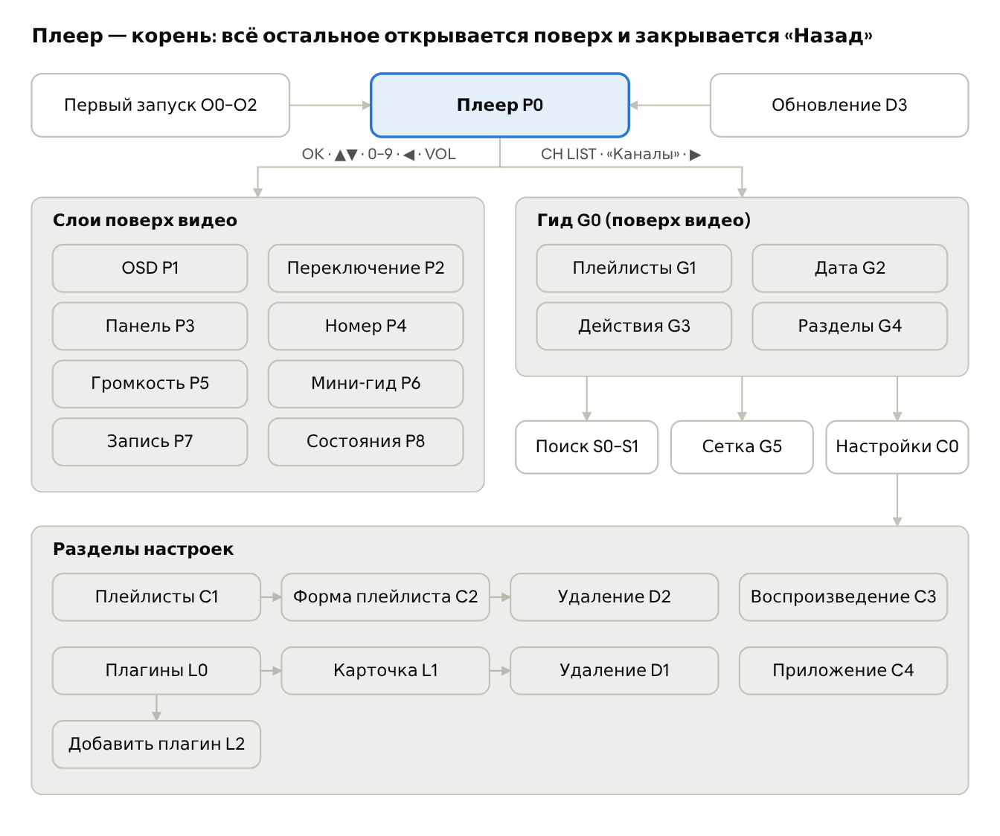

# IPTV — спецификация передачи в разработку

11 ноября 2026

## О документе

Это полная спецификация для реализации нового интерфейса IPTV в репозитории [volnalabs/IPTV](https://github.com/volnalabs/IPTV) без смены архитектуры: Android остаётся на Kotlin Views и Media3, Samsung, LG и компьютер — на общем web-интерфейсе ES5. Всё, чего здесь нет, в продукт не добавляется.

**Источники.** Макеты и прототип — [холст «IPTV — проектирование интерфейса»](https://claude.ai/artifact/Wvxbggj4a3edB9JAC5j39K) (62 экрана, страницы «Структура», «Аудит доступности», «Прототип», «ТВ», «Компьютер», «Телефон и планшет», «Спецификация»). Токены и компоненты — [дизайн-система «Тихий эфир»](https://claude.ai/artifact/9DvZ53vo9amJqCtfGadNzt). Код сверен с веткой `main`, коммит `3d8bd8b`.

**Единицы.**

- ТВ на web (Samsung, LG): пиксели холста 1920×1080; `fit()` в `web/app.js` масштабирует холст под экран (720p — ×0,667, 4K — ×2).
- Android TV: dp. Холст 1920 px = 960 dp, то есть **dp = px холста ÷ 2** (строка канала 104 px → 52 dp, кегль 30 px → 15 sp).
- Компьютер: CSS px окна, без масштабирования холста (см. раздел «Адаптация платформ»).
- Телефон и планшет Android: dp и sp.

**Обозначения.**

| Метка | Значение |
| --- | --- |
| `новое` | Функции нет в приложении, её добавление согласовано. В интерфейсе показывается жёлтая метка «новое» до первого открытия раздела (хранится флаг `seen_<feature>`) |
| `поведение` | Существующая функция работает иначе, чем сейчас |
| ТВ-web | Общий web-интерфейс в режиме телевизора: Samsung Tizen, LG webOS |
| Desktop | Тот же web-интерфейс в Electron, режим окна |
| Android TV / Mobile | Нативный интерфейс `app/` (Kotlin Views, Media3) |

**Согласованные изменения поведения.**

| № | Было в коде | Станет |
| --- | --- | --- |
| 1 | ▲▼ в плеере сразу включает соседний канал (`step()`) | ▲▼ листает плашку канала; поток включается через 400 мс после последнего нажатия |
| 2 | OK в плеере открывает гид | OK открывает панель управления. Гид — ◀, CH LIST или кнопка «Каналы» на панели |
| 3 | Удержание OK переключает избранное | Удержание OK (650 мс) открывает меню действий; избранное — пункт меню и зелёная кнопка |
| 4 | «Сохранить» сначала записывает ссылку, при ошибке список пропадает | Ссылка сначала загружается и разбирается; сохраняется только при успехе, иначе работает прежний список |
| 5 | Плагин удаляется сразу | Диалог подтверждения, фокус на «Отмена», затем тост «Вернуть» на 6 с |

**Новые функции** (все помечены `новое`): несколько плейлистов; раздел «Недавние»; поиск передач по телепрограмме; громкость и «Без звука» с экранной шкалой; описание текущей передачи из тега `<desc>`; сетка «каналы × время»; ошибка запуска плагина в его карточке.

**Не реализуем** — этого нет в продукте и в макетах: родительский контроль, субтитры, звуковые дорожки, смена темы, диагностика сети, статистика потока, история поисковых запросов, сортировка избранного, настройки плагинов, каталог или магазин плагинов, пауза прямого эфира, разделы настроек «Сеть» и «Хранилище».

## 1. Карта экранов

В приложении один корневой экран — плеер; всё остальное — слои поверх него, и «Назад» всегда снимает ровно один слой. В web слой — это значение `S.zone` (`play`, `channels`, `groups`, `epg`, `search`, `setup`, `plugins`, `dialog`) плюс новые `ctl`, `mini`, `grid`, `ctx`, `plm`; на Android — видимость панелей `MainActivity` и отдельные Activity (`SettingsActivity`, `PluginsActivity`, `UpdateActivity`).

Из любого прямоугольника «Назад» ведёт по стрелке в обратную сторону, а OK на канале или передаче в любом списке сразу возвращает в плеер.

### Экраны и слои

| ID | Экран или слой | Платформы | Откуда попадаем | Как уходим («Назад» и др.) | Макет на холсте |
| --- | --- | --- | --- | --- | --- |
| P0 | Плеер · чистый экран | Все | Запуск (последний канал); OK на канале или передаче в любом списке | 1-е «Назад»: скрыть инфо, если показано, иначе тост «Нажмите «Назад» ещё раз, чтобы выйти»; 2-е за 2 с — выход | TV-Player-Info |
| P1 | Инфо о канале (OSD) | Все | Переключение канала, INFO, «О передаче» на панели, смена запись ↔ эфир | Само через 5 с; INFO или «Назад» | TV-Player-Info |
| P2 | Быстрое переключение | ТВ, Desktop | ▲▼, CH±, ↑↓ | Поток стартует через 400 мс после последнего нажатия → P1 | TV-Player-Zap |
| P3 | Панель управления | ТВ (OK), Desktop (движение мыши), телефон в горизонтали (касание) | См. платформы | 4 с без ввода; «Назад»; ▲▼ закрывают панель | TV-Player-Controls |
| P4 | Ввод номера | ТВ, Desktop | Цифра 0–9 в любом слое, кроме полей ввода и поиска | OK или таймер — включить; «Назад» — отмена без переключения | TV-Player-Number |
| P5 | Шкала громкости `новое` | Все | VOL±, MUTE, M (Desktop), «Без звука» на панели | Сама через 2 с; значок «Без звука» остаётся, пока звук выключен | TV-Player-Volume |
| P6 | Мини-гид поверх видео | ТВ; Desktop в полном экране | ◀ в чистом плеере | «Назад» → P0; ◀ → G0 (фокус в меню); ▶ → G0 (фокус в программе); OK — включить и закрыть | TV-MiniGuide |
| P7 | Запись передачи (архив) | Все | OK на прошедшей передаче со значком записи (гид, поиск, сетка) | «Назад» или «Вернуться в эфир» → эфир того же канала + тост «Прямой эфир» | TV-Archive |
| P8 | Состояния плеера (10) | Все | Сами по событиям плеера | См. раздел 3 | TV-Player-States |
| G0 | Гид: меню · каналы · подробности | Все (на Desktop и телефоне — своя компоновка) | CH LIST, «Каналы» на панели, ◀ из мини-гида, ▶ в плеере (программа текущего канала), удержание OK в плеере (сразу с G3) | Из G1, G2 — на шаг назад; иначе → P0 + P1 | TV-Guide |
| G1 | Меню плейлистов `новое` | Все | ▲ с первого пункта меню → заголовок «Домашний ⌄» → OK; Desktop — кнопка в шапке | «Назад» → заголовок; выбор другого плейлиста → загрузка и G0; «Управлять плейлистами» → C1 | Прототип ТВ |
| G2 | Строка даты программы | Все | ▲ с первой передачи | ▼ или «Назад» → передачи | Прототип ТВ |
| G3 | Действия с каналом `поведение` | ТВ (удержание OK), Desktop (ПКМ), телефон (долгое касание) | Удержание OK на плитке канала, в плеере, в результатах поиска и сетке | «Назад» → тот слой, откуда открыли | TV-Guide-Context |
| G4 | Разделы «Избранное», «Недавние» `новое`, «Все каналы», группы | Все | Пункт меню гида; зелёная — Избранное в гиде | ◀ → меню; «Назад» → P0 | TV-Favorites, TV-Recent |
| G5 | Сетка «каналы × время» `новое` | ТВ, Desktop, планшет | «Телепрограмма» на панели; «Найти в сетке» в G3; кнопка «Сетка» над программой (Desktop, планшет) | «Назад» → тот слой, откуда открыли | TV-EPG-Grid, Desk-EPG |
| S0 | Поиск · клавиатура | ТВ (экранная), Desktop (поле в шапке), телефон (системная) | Красная, SEARCH, «Поиск» в меню; Desktop — начать печатать | «Назад» → откуда открыли (плеер или меню гида) | TV-Search |
| S1 | Поиск · результаты по разделам | Все | ▶ с правого края клавиатуры; ↓ из поля (Desktop) | ◀ или «Назад» → S0 | TV-Search-Results |
| C0 | Настройки · разделы | Все | Синяя, MENU, SETTINGS; «Настройки» в меню гида; «Ещё → Настройки» | Из содержимого → список разделов → откуда открыли | TV-Settings |
| C1 | Плейлисты `новое` | Все | C0 → «Плейлисты»; G1 → «Управлять плейлистами» | → C0 | TV-Settings-Playlists |
| C2 | Плейлист · добавить или изменить | Все | OK на плейлисте или «Добавить плейлист» | «Назад» → C1; несохранённое сбрасывается с тостом «Изменения не сохранены» | TV-Playlist-Edit, TV-Settings-States |
| C3 | Воспроизведение | Только Android | C0 | → C0 | TV-Settings |
| C4 | Приложение (обновления, версия, «С телефона») | Все; «С телефона» — Android TV | C0 | → C0 | Phone-Settings, TV-Settings |
| L0 | Плагины · список | Все | C0 → «Плагины»; Desktop — пункт в боковой колонке; «Ещё → Плагины» | → C0 (фокус на «Плагинах»). Web: если были изменения — перезапуск через 600 мс (как сейчас `closePlugins()`) | TV-Plugins |
| L1 | Карточка плагина | Все | OK на плагине | → L0 | TV-Plugin-Detail |
| L2 | Добавить плагин | Все | «Добавить плагин» в конце L0 | → L0 | TV-Plugin-Add |
| D1 | Диалог «Удалить плагин?» `поведение` | Все | «Удалить» в L1 или в меню удержания L0 | «Назад» = «Отмена» | TV-Plugin-Delete |
| D2 | Диалог «Удалить плейлист?» | Все | «Удалить плейлист» в C2 | «Назад» = «Отмена» | TV-Settings-States |
| D3 | Обновление приложения | Все | Само при запуске (если «Обновлять автоматически» включено, раз в час на web); «Проверить обновления» в C4 | «Позже» или «Назад» → предыдущий слой | TV-Update |
| O0 | Первый запуск · с телефона по QR | Android TV | Нет ссылки на плейлист | «Назад» — выход из приложения | TV-Onboarding |
| O1 | Первый запуск · поле ссылки | Samsung, LG, Desktop, телефон | Нет ссылки на плейлист | «Назад» — выход (как сейчас `exitApp()`) | TV-Onboarding-Web |
| O2 | Загрузка списка каналов | Все | «Открыть» в O1 или ссылка с телефона | Успех → P0 с первым каналом; ошибка → O0/O1 с текстом ошибки в поле | TV-Onboarding-Loading |
| E0 | Пустые состояния и ошибки списка | Все | Пустое избранное или недавние, ничего не найдено, плейлист без каналов, список не обновился | Фокус остаётся в меню или на кнопке действия | TV-Empty-States |

### Ключевые сценарии

Каждый проверен в прототипе ТВ (30 сценариев) и пользуется как приёмочный тест.

1. **Первый запуск.** O0 или O1 → ссылка → O2 → первый канал играет, P1 на 5 с. Ошибка ссылки оставляет на O0/O1 с текстом причины.
2. **Включить канал из гида.** P0 → CH LIST → G0 (фокус на играющем канале) → ▲▼ → OK → P0 + P1. Всего одно нажатие OK на нужном канале.
3. **Быстрое переключение.** Десять нажатий ▲ за 2 с дают один запуск потока, на десятом канале.
4. **Номер канала.** «1» → подсказки 1, 10, 11, 12 → ▼ → OK. Пустой результат — «Канала с номером … нет», через 2 с слой закрывается.
5. **Запись.** G0 → ▶ → прошедшая передача со значком записи → OK → P7 → ◀▶ ±30 с, OK пауза → «Назад» → эфир.
6. **Избранное.** Удержание OK на канале → G3 → «Добавить в избранное» → тост; зелёная делает то же сразу.
7. **Поиск передачи.** Красная → S0 → «футбол» → ▶ → S1 → «Идёт сейчас» → OK → P0; из «Записей» → P7.
8. **Смена плейлиста.** G0 → ▲ до заголовка → OK → G1 → «Спорт» → загрузка → G0 нового плейлиста.
9. **Изменить ссылку плейлиста.** C1 → C2 → новая ссылка → «Проверить и сохранить» → ошибка 404 → прежний список работает, текст под полем.
10. **Плагин.** C0 → L0 → L2 → ссылка → «Установить» → L0; удаление → D1 → тост «Вернуть» 6 с.
11. **Обновление.** Запуск → D3 «Вышла версия…» → «Обновить» → прогресс → перезапуск с тем же каналом.

На Desktop и телефоне те же экраны собраны иначе (раздел 7): гид и плеер видны одновременно, поэтому слоёв P6 и G0 как отдельных экранов там нет.

## 2. Дизайн-токены

Токены — единственный источник цветов, размеров и времени. Исходник — `tokens.json` дизайн-системы; в web он превращается в готовые значения внутри `style.css` на шаге сборки (`var()` на Samsung 2016–2017 не работает), на Android — в `res/values/colors.xml` и `dimens.xml`. Тёмная тема единственная.

### Цвет: поверхности и текст

| Токен | Значение | Где применяется |
| --- | --- | --- |
| `video-black` | #000000 | Фон под видео, чёрные полосы |
| `bg-canvas` | #0D0D0E | Фон приложения, настроек, первого запуска |
| `bg-secondary` | #131314 | Боковая колонка и шапка Desktop |
| `surface-1` | #19191B | Панели, ячейки сетки, подложка предупреждения |
| `surface-2` | #222225 | Диалоги, меню, тосты, поля ввода, клавиши экранной клавиатуры, выбранная строка (`selected-bg`) |
| `surface-3` | #2C2C30 | Кнопки в покое, выбранный пункт меню гида на ТВ, наведение |
| `surface-3-hover` | #36363B | Плитка канала в гиде, наведение на кнопку, кнопка подсказки пульта |
| `scrim` | rgba(10,10,11,0.80) | Подложка под диалогом, плашки громкости и переключения |
| `scrim-guide` | rgba(13,13,14,0.94) | Гид поверх играющего видео |
| `scrim-mini` | rgba(10,10,11,0.90) | Мини-гид (левые 1000 px) |
| `scrim-video` | rgba(0,0,0,0.62) | Нижняя тень на Desktop и телефоне |
| `shade-osd` | градиент снизу 66 % высоты: 0 → rgba(0,0,0,0.55) на 40 % → rgba(0,0,0,0.86) | Под OSD и панелью на ТВ. Ниже 0,86 не опускать: на ярком кадре падает контраст |
| `shade-top` | градиент сверху 30 %: rgba(0,0,0,0.5) → 0 | Под верхней строкой панели (подсказки, часы) |
| `text-primary` | #F2F0EC | Основной текст, названия каналов и передач |
| `text-secondary` | #B8B5AF | Вторичный текст, время, группа, описание, подписи подсказок. **На видео — самый тёмный допустимый** |
| `text-tertiary` | #9A978F | Счётчики, заголовки секций, номера не в фокусе, «удерж.». Только на сплошном фоне, не на видео |
| `text-disabled` | #5F5D59 | Недоступные кнопки, шкала громкости без звука |
| `text-inverse` | #141415 | Текст на «бумаге» (фокус ТВ, основная кнопка) |
| `text-inverse-secondary` | #56534D | Вторичный текст и иконки на «бумаге» |
| `line-subtle` | #2E2E32 | Разделители, рамки меню и диалогов |
| `line-control` | #77767C | Рамки полей, переключателей в покое, клавиш клавиатуры |

### Цвет: фокус, акцент, статусы

| Токен | Значение | Правило |
| --- | --- | --- |
| `paper` (= `focus-fill`, `focus-ring`, `active-indicator`) | #EFEAE0 | Фокус на ТВ (заливка или кольцо), основная кнопка, включённый переключатель, плашка «Запись» |
| `paper-hover` / `paper-pressed` | #F8F5EF / #DDD7CB | Наведение и нажатие основной кнопки |
| `accent` (= `live`, `progress-live`) | #E8956A | **Только «сейчас»**: метка «Эфир», играющий канал, прогресс текущей передачи, линия «сейчас» в сетке, точка у группы играющего канала. Не для кнопок, фокуса, ссылок |
| `accent-ring` | rgba(232,149,106,0.55) | Кольцо 4 px играющей плитки канала |
| `accent-on-paper` | #A0461C | Акцент внутри фокуса «бумагой» |
| `on-accent` | #1C120C | Текст на акцентной заливке (не используется в текущих макетах) |
| `accent-subtle` | rgba(232,149,106,0.16) | Зарезервирован |
| `progress-track` / `progress-fill` / `progress-buffer` | rgba(242,240,236,0.16) / #9A978F / rgba(242,240,236,0.32) | Дорожка, заполнение не-эфирного прогресса, буфер записи |
| `progress-track-on-paper` / `progress-fill-on-paper` | rgba(20,20,21,0.16) / #56534D | Прогресс внутри фокуса |
| `osd-track` | rgba(242,240,236,0.28) | Дорожка прогресса в OSD |
| `osd-tile` | rgba(242,240,236,0.14) | Подложка логотипа в OSD |
| `ctl-btn` | rgba(242,240,236,0.10) | Кнопки панели управления в покое |
| `ctl-sep` | rgba(242,240,236,0.16) | Разделитель групп кнопок панели; тот же цвет — подложка подсказки пульта на видео |
| `skeleton` / `skeleton-highlight` / `logo-tile` | #1F1F22 / #28282C / #1F1F22 | Заглушки загрузки, подложка логотипа |
| `error` / `error-on-paper` / `error-subtle` | #F06977 / #B4232F / rgba(240,105,119,0.14) | Ошибки: текст под полем, статус плагина, опасная кнопка |
| `warning` / `warning-subtle` | #E3BD62 / rgba(227,189,98,0.14) | Предупреждения, «нет связи»; тот же цвет — фон метки «новое» (текст #1C160A) |
| `success` / `success-subtle` | #74C79A / rgba(116,199,154,0.14) | «Работает», «Сохранено», «Связь восстановлена» |

Статус никогда не передаётся одним цветом: всегда цвет + иконка + слово. Текущие цвета Android (`accent` #FF7A45, `focus` #F5F3EE, `bg` #0B0C0F, `archive` #7FD6A8, `star` #FFC24A, `on_air` #E5484D) заменяются токенами выше; отдельных цветов для звезды, архива и буквенных логотипов больше нет (массив `COLORS` в `app.js` и `LetterDrawable` переходят на нейтральную плитку).

### Типографика

Шрифт Onest (400, 500, 600, 700), запасные: SamsungOne, «LG Smart UI», Segoe UI, Helvetica Neue, Arial, sans-serif. Все цифры (номера, время, счётчики) — табличные: `font-variant-numeric: tabular-nums` в web, `fontFeatureSettings = "tnum"` на Android.

| Роль | ТВ, px холста (размер / строка / насыщ.) | Desktop, px | Телефон, sp |
| --- | --- | --- | --- |
| display | 64 / 72 / 600, −0,01em | 32 / 40 / 600 | 22 / 28 / 600 |
| headline | 44 / 52 / 600 | 24 / 32 / 600 | 20 / 26 / 600 |
| title | 36 / 44 / 600 | 18 / 24 / 600 | 17 / 22 / 600 |
| channel | 32 / 40 / 500 | 15 / 20 / 500 | 16 / 22 / 500 |
| programme | 30 / 38 / 400 | 14 / 20 / 400 | 15 / 20 / 400 |
| body | 30 / 40 / 400 | 14 / 20 / 400 | 15 / 22 / 400 |
| meta, time, number | 28 / 36 / 400–500 | 13 / 18 / 400–500 | 13 / 18 / 400–500 |
| caption | 24 / 32 / 500 | 12 / 16 / 500 | 12 / 16 / 500 |
| numpad | 112 / 112 / 600 | 48 / 48 / 600 | — |

Компоненты гида в стиле Lampa и OSD имеют свои кегли (раздел 3): название канала в подробностях 76/88/700, название в OSD 72/84/700, буквы плитки 76/80/600. **Минимум на ТВ — 22 px холста** (14,7 px на 720p); всё читаемое с дивана — от 24 px.

### Отступы, размеры, радиусы

| Группа | Токены |
| --- | --- |
| Отступы (шаг 4) | `space-1` 4 · `space-2` 8 · `space-3` 12 · `space-4` 16 · `space-5` 20 · `space-6` 24 · `space-8` 32 · `space-10` 40 · `space-12` 48 · `space-16` 64 |
| Безопасные поля ТВ | `tv-safe-x` 96 · `tv-safe-y` 54 (5 % холста). Ничего читаемого за пределами |
| Элементы управления | `size-control-sm` 32 · `md` 40 · `lg` 48 (касание) · `tv` 64 |
| Строки | канал: Desktop 56, телефон 64, ТВ 104 · передача ТВ 80 · пункт меню: Desktop 36, ТВ 72 (в гиде Lampa — 70) |
| Иконки | 16 · 20 · 24; ТВ 28–40 по месту (см. компоненты) |
| Логотипы | Desktop 48×36 · телефон 56×42 · ТВ-строка 112×84 · OSD 200×140 · плитка гида 340×236 |
| Колонки | боковая Desktop 240 · диалог Desktop 480, ТВ 960 · чтение 640 · контент 1200 |
| Радиусы | `radius-xs` 2 · `sm` 4 · `md` 6 · `lg` 10 · `full` 999. ТВ: кнопки и строки 12, пункт меню и передачи в гиде 14–16, диалоги и тосты 20, плитка 24, кольцо фокуса плитки 34 |
| Линии | `border-hairline` 1 (ТВ 2) · `focus-ring-width` 2, `focus-ring-offset` 2 (Desktop) · прогресс 3 / 4 в плеере; ТВ 4, в гиде и OSD 6, шкала записи 8 (в фокусе 16) |
| Слои (z-index) | `z-video` 0 · `z-player` 10 · `z-guide` 20 · `z-popover` 30 · `z-dialog` 40 · `z-toast` 50 |
| Недоступность | `opacity-disabled` 0,4 — только для полей и переключателей; текст делается `text-disabled`, не прозрачностью |
| Тени | `shadow-popover` 0 8 24 rgba(0,0,0,0.45) — только Desktop и телефон. На ТВ теней нет: рамка 2 px `line-subtle` |

### Движение и время

| Токен | Значение | Что управляет |
| --- | --- | --- |
| `duration-fast` | 100 мс | Смена фона фокуса и наведения, переключатель |
| `duration-base` | 160 мс | Появление тоста, меню, панели (opacity) |
| `duration-slow` | 240 мс | Появление гида и OSD (opacity + translateY 24 px) |
| `ease-standard` / `ease-exit` | cubic-bezier(0.2,0,0,1) / (0.4,0,1,1) | Появление / исчезновение |
| `duration-zap-delay` | 400 мс | Запуск потока после последнего ▲▼ |
| `duration-info` | 5000 мс | Показ OSD (как сейчас в `showInfo()`) |
| `duration-controls-idle` | 4000 мс | Скрытие панели без ввода; для мыши тоже 4000 (сейчас 3500 в `pointerIdle`) |
| `duration-toast` | 3000 мс; с кнопкой «Вернуть» — 6000 мс | Тост (сейчас 3500 в `toast()`) |
| `duration-volume` | 2000 мс | Шкала громкости |
| `duration-hold` | 650 мс | Удержание OK (как сейчас в `handleKey`) |
| `duration-number` | 3000 мс; 1000, если других совпадений быть не может; 2000 для «нет канала» | Автопереход ввода номера (как сейчас `numArm`) |
| `duration-exit` | 2000 мс | Окно для второго «Назад» перед выходом |

Анимируются только `opacity` и `transform`. Фокус перемещается мгновенно, без анимации положения и без масштаба. На Samsung и LG 2016–2018 (определяется по версии браузера, см. раздел 10) анимации отключаются классом `body.lite`.

## 3. Компоненты

Размеры даны для ТВ в px холста 1920×1080 (Android TV — ÷2 в dp), для Desktop и телефона — в их единицах. Имена классов — из дизайн-системы (`ip-*`) и холста (`sc-*`); в коде их можно назвать иначе, но состав и состояния должны совпадать.

### 3.1 Главный гид (ТВ)

Три колонки по образцу Lampa поверх играющего видео: меню разделов, плитки каналов, подробности с программой. Видео продолжает играть со звуком под подложкой `scrim-guide`.

| Зона | Геометрия |
| --- | --- |
| Шапка `sc-lg-head` | top 40, left/right 96, высота 88; слева заголовок-плейлист, справа часы |
| Тело `sc-lg-body` | top 150, bottom 132, left/right 96 → 1728×798; flex-строка |
| Меню `sc-lg-menu` | ширина 450 + отступ справа 56 (зазор до номеров каналов ≈ 70 px видимый) |
| Каналы `sc-lg-chs` | ширина 520, padding-top 18, overflow hidden, градиенты 120 px сверху и снизу до rgba(13,13,14,0.96) |
| Подробности `sc-lg-det` | остаток (702), padding-left 56 → контент 646, снизу градиент 120 px |
| Подсказки `sc-tv-foot` | bottom 54, left/right 96, высота 52 |

#### Заголовок-плейлист и часы

- **Заголовок** `sc-lg-title`: иконка `list` 36 + название активного плейлиста 44/52/400 `text-primary` + `chevron-down` 36 `text-secondary` + метка «новое». Высота 72, padding 0 20, margin-left −20 (текст выровнен по полю 96), radius 16, gap 16. Фокус: заливка `paper`, текст и иконки `text-inverse`. Один плейлист — стрелка не рисуется, фокус на заголовок не попадает. Длинное имя — обрезка многоточием по 900 px.
- **Часы** `sc-lg-clock`: время 48/56/600 tabular + две строки 24/28 `text-secondary` («11 ноября 2026», «Среда»), gap 16, обновление раз в минуту.

#### Меню разделов `sc-lg-mi`

| Часть | Размер и отступы | Цвет и шрифт |
| --- | --- | --- |
| Пункт | высота 70, padding 0 24, radius 16, gap 20 | 30/38/400 `text-secondary` |
| Иконка | 32×32 | currentColor |
| Название | flex 1, одна строка, многоточие | — |
| Счётчик | справа | 28 tabular `text-tertiary` |
| Точка «здесь играет» | 12×12, круг, перед счётчиком | `accent` |
| Заголовок «Группы» `sc-lg-sect` | высота 52, padding 0 24 8, текст прижат к низу | 24/32 `text-tertiary` |
| Разделитель `sc-lg-sep` | 2 px, margin 12 24 | `line-subtle` |

| Состояние | Вид |
| --- | --- |
| Покой | Без фона, `text-secondary` |
| Выбран раздел (фокус в другой колонке) | Фон `surface-3`, текст `text-primary` 500, счётчик `text-secondary` |
| Фокус | Фон `paper`, текст `text-inverse` 500, счётчик `text-inverse-secondary`, точка `accent-on-paper` |

Состав сверху вниз: Поиск · Избранное (счётчик) · Недавние (счётчик, «новое») · Все каналы (счётчик) · «Группы» · группы плейлиста в порядке файла · разделитель · Настройки. «Плагины» из меню гида ТВ убраны в настройки. Верхние четыре пункта и «Настройки» закреплены, группы прокручиваются между ними так, чтобы фокус всегда был виден. Список не зациклен (сейчас в коде он идёт по кругу): ▲ с «Поиска» ведёт на заголовок-плейлист. Пустая группа не показывается; «Избранное» и «Недавние» показываются всегда (счётчик 0 скрыт).

#### Плитка канала `sc-lg-ch`

| Часть | Размер и отступы | Цвет и шрифт |
| --- | --- | --- |
| Строка | высота 236, margin-bottom 28 (шаг 264), flex, align center | — |
| Номер | ширина 136, выравнивание вправо, padding-right 24; три знака с ведущими нулями («005»), четыре — если каналов больше 999 | 48/56/600 tabular `text-tertiary`; в фокусе `text-primary` |
| Плитка | 340×236, radius 24, колонка по центру, gap 10 | фон `surface-3-hover` |
| Логотип | картинка `contain` в области 240×120 | — |
| Буквы вместо логотипа | 1–3 буквы из названия («РК», «5К», «ТВЦ») | 76/80/600, −0,02em, `text-primary` |
| Название | max-width 290, одна строка, многоточие | 26/32 `text-secondary` |
| Значки | top 16, right 18, gap 12, иконки 30: «играет» (`playing`), «в избранном» (`star-filled`) | `accent` / `text-primary` |

| Состояние | Вид |
| --- | --- |
| Покой | Плитка без кольца |
| Фокус | Кольцо `paper` 6 px на расстоянии 8 px от плитки (внешний контур на −14 px, radius 34); номер `text-primary`. Размер плитки не меняется |
| Играет | Кольцо `accent-ring` 4 px на −12 px + значок «играет» |
| Фокус + играет | Кольцо фокуса перекрывает акцентное; значок «играет» остаётся |
| Логотип грузится или не загрузился | Буквы на нейтральной плитке; картинка появляется поверх после `onload`. Цветных плашек нет |

Прокрутка: фокус стоит на второй позиции (смещение списка −130 px — сверху видна нижняя часть предыдущего канала), список двигается под ним шагом 264. У первого канала смещение 0. В DOM — не больше 5 плиток (видимые + по одной с каждой стороны), виртуализация как в текущем `winTop()`.

#### Подробности канала и EPG в гиде

| Часть | Размер и отступы | Цвет и шрифт |
| --- | --- | --- |
| Строка «сейчас» `sc-lg-now` | margin-top 10, gap 16: плашка архива + название текущей передачи (многоточие) | 30/38 `text-secondary` |
| Плашка архива `sc-lg-badge` | высота 40, padding 0 14, radius 8. Текст «Архив · N дн» из `catchupDays`; нет архива — плашки нет | фон `surface-3-hover`, 24/500 `text-primary` |
| Название канала `sc-lg-name` | margin-top 6, одна строка, многоточие | 76/88/700, −0,015em |
| Строка даты `sc-lg-date` | высота 56, padding 0 18, radius 12, gap 14, margin 34 0 10 148 (текст на линии названий передач); в фокусе margin-left 130 и стрелки ◀ ▶ 28 по краям | 28 `text-secondary`; фокус — `paper` / `text-inverse` |
| Строка передачи `sc-lg-pr` | padding 12 18, margin 0 −18 4, radius 14, flex | — |
| Время | ширина 116 | 30/40 tabular `text-secondary` |
| Значок | колонка 48, иконка 28: «идёт» `play-filled`, «есть запись» `history`, иначе пусто | `accent` / `text-secondary` |
| Название | одна строка, многоточие | 30/40 `text-primary`; прошедшая — `text-secondary` |
| Прогресс (только у «идёт») | высота 6, radius 3, margin-top 14 | дорожка `progress-track`, заполнение `accent` |
| Описание `новое` | margin-top 14, до 4 строк (`-webkit-line-clamp: 4`) | 26/36 `text-secondary` |

- Видно 5 строк: одна прошедшая, текущая, три следующих. При движении фокуса окно сдвигается так, чтобы фокус был второй строкой.
- Описание показывается только у текущей передачи и только если в XMLTV есть `<desc>`; иначе строка описания не рисуется и место не резервируется.
- Фокус на строке: фон `paper`, название `text-inverse`, время/значок/описание `text-inverse-secondary`, «идёт» `accent-on-paper`, прогресс `progress-track-on-paper` + `accent-on-paper`.
- Нет телепрограммы: название канала + блок состояния слева (иконка `guide` 56, «Для этого канала телепрограммы нет» 36/44/600, «Провайдер не передаёт расписание. Канал можно смотреть.» 30/40 `text-secondary`). ▶ в эту колонку не переводит фокус.
- Телепрограмма ещё грузится: вместо строк — статус `ip-status` со спиннером 32 и текстом из `setEpgStatus()` («Загружаю программу… N»), 28/36.
- Дни: только те, что есть в загруженной программе; формат «Вчера, 10 ноября», «Сегодня, 11 ноября», «Завтра, 12 ноября», дальше «Пт, 13 ноября». Дальше крайнего дня — стрелка с этой стороны скрыта.

#### Меню плейлистов и меню действий

Оба — вариант `ip-menu` для ТВ: min-width 520, padding 12, radius 20, фон `surface-2`, рамка 2 px `line-subtle`, без тени. Заголовок меню 24/32 `text-tertiary`, padding 12 24 8. Пункт: высота 72, padding 0 24, gap 20, radius 12, 30 px; иконка 36 `text-secondary`; справа — кнопка пульта, которая делает то же без меню, 22 px `text-secondary`. Фокус: `paper` / `text-inverse`, иконка `text-inverse-secondary`. Опасный пункт — `error`, в фокусе `error-on-paper`.

| Меню | Положение | Пункты |
| --- | --- | --- |
| Плейлисты (G1) | left 96, top 136 (под заголовком) | Плейлисты в порядке добавления: название + «N каналов» 26 `text-tertiary`, у активного — иконка `check`; не загрузившийся — `text-disabled` + «не загрузился», фокус на него пропускается. Разделитель. «Управлять плейлистами» (иконка `settings`) |
| Действия с каналом (G3) | left 1080, top 380 — справа от плитки в фокусе, поверх подробностей | Заголовок «Россия К · 005». Смотреть \[OK\] · Добавить в избранное / Убрать из избранного \[зелёная\] · Программа канала \[▶\] · Найти в сетке телепрограммы. Фокус при открытии — «Смотреть» |

На Desktop меню действий открывается у курсора (вариант `ip-menu` 220+ px, пункт 36, тень `shadow-popover`), на телефоне — нижняя шторка `ip-sheet` с пунктами 48 dp.

#### Подсказки кнопок `ip-keys`

Строка подсказок внизу гида, поиска, настроек и вверху панели управления. Меняется вместе с фокусом (список для каждой зоны — раздел 8).

| Часть | ТВ | Desktop |
| --- | --- | --- |
| Подсказка | margin-right 52 до следующей; подпись 24/32 `text-secondary` | margin-right 28; 13/18 |
| Кнопка пульта круглая (OK, ◀, ▶, ▲, ▼) | 44×44, radius 22, фон `surface-3-hover`, иконка-стрелка 26 (stroke 2,4) или «OK» 19/700, отступ до подписи 14 | 24×24, иконка 14, текст 11 |
| Пара стрелок (◀ ▶, ▲▼) | один овал высотой 44, padding 0 10, две иконки | то же в 24 |
| Текстовая («Назад», «0–9», «Красная») | овал высотой 44, padding 0 16, radius 22, 19/700, letter-spacing 0,02em | — |
| Удержание | слово «удерж.» 22 `text-tertiary` перед кнопкой + второе кольцо: box-shadow 0 0 0 3 `bg-canvas`, 0 0 0 5 `text-tertiary` | «ПКМ» как клавиша |
| Клавиша клавиатуры (Esc, Enter, Backspace, ↑↓) | — | прямоугольная 24 высотой, radius 5, padding 0 7, `surface-3-hover`, inset 0 −2 0 rgba(0,0,0,0.45), 11/600 |
| На видео | фон кнопки rgba(255,255,255,0.16) | то же |

На Desktop подсказки показывают клавиши (`KEYS` в `app.js` уже подменяет OK→Enter, Назад→Esc), кликабельны (`data-a`), при наведении фон кнопки `paper`, текст `text-inverse`. На телефоне подсказок нет.

## 4. Активный плеер

Видео всегда на первом месте: в покое на экране нет ничего, каждый слой исчезает сам или по «Назад», а прямой эфир не ставится на паузу. Сейчас в коде плеер — это `#video`/`#av` + `#info` + `#bar` (web) и `PlayerView` + `infoBar` (Android); новые слои добавляются рядом, движок воспроизведения (hls.js, AVPlay, Media3) не меняется.

### 4.1 Слои и таймеры

| Слой | Появляется | Скрывается | Может быть вместе с |
| --- | --- | --- | --- |
| Чистый экран | Все слои скрыты | — | Значок «Без звука», метка записи |
| OSD (инфо) | Переключение канала; INFO; «О передаче»; возврат из гида; смена передачи на канале (на 5 с) | 5 с без ввода; INFO; «Назад»; на паузе записи не скрывается | Тост, громкость (верхняя строка OSD с часами тогда скрыта) |
| Панель управления | OK (ТВ), движение мыши (Desktop), касание (телефон); в записи — ещё ◀▶ и OK | 4 с без ввода; «Назад»; ▲▼; второе касание; увод курсора. Курсор над панелью таймер останавливает | OSD сдвинут вверх (bottom 200/240), тост, громкость |
| Быстрое переключение | ▲▼, CH± в чистом экране или с OSD | Через 400 мс после последнего нажатия → запуск потока, OSD на 5 с | OSD целевого канала |
| Ввод номера | Цифра | Таймер (3 с / 1 с / 2 с — раздел 2), OK, «Назад» | Закрывает OSD, панель, мини-гид |
| Громкость | VOL±, MUTE, M, «Без звука» | 2 с после последнего нажатия | Любым слоем, кроме диалога |
| Мини-гид | ◀ в чистом экране или с OSD | OK (включив канал), «Назад», ◀/▶ (переход в гид). Автоскрытия нет | Тост, громкость |
| Гид и сетка поверх видео | Раздел 1, G0 и G5 | «Назад»; OK на канале или передаче | Звук и видео идут под ними |
| Загрузка, буфер, ошибки | События плеера (4.4) | При старте воспроизведения, смене канала | ▲▼, цифры, гид работают всегда |

При открытии любого слоя с фокусом (панель, мини-гид, номер, гид) предыдущий слой с фокусом закрывается: два фокусируемых слоя одновременно не открыты. Все таймеры сбрасываются любым нажатием внутри своего слоя.

### 4.2 Панель управления: кнопки

При открытии фокус на первой кнопке (в записи — на «Пауза»). ◀▶ двигают фокус без перехода по кругу, OK нажимает, над рядом — подпись кнопки в фокусе. На Desktop та же подпись — всплывающая подсказка с клавишей и `aria-label` кнопки.

| Группа | Кнопка (иконка) | Подпись | Действие | Когда недоступна |
| --- | --- | --- | --- | --- |
| Эфир · 1 | `list` | Каналы — список | G0, фокус на играющем канале | — |
| Эфир · 1 | `chevron-up` | Канал выше | Следующий канал (с задержкой 400 мс) | — |
| Эфир · 1 | `chevron-down` | Канал ниже | Предыдущий канал в списке | — |
| Эфир · 1 | `previous` | Предыдущий канал | Канал, смотревшийся перед текущим (LAST, Backspace) | Ещё не переключались |
| Эфир · 2 | `info` | О передаче | Закрыть панель, OSD на 5 с | — |
| Эфир · 2 | `guide` | Телепрограмма — сетка каналов `новое` | G5, фокус на текущей передаче играющего канала | Телепрограмма не загружена |
| Эфир · 2 | `history` | Записи этого канала | G0, фокус в программе играющего канала | У канала нет `catchup`: вид недоступной кнопки, фокус на неё попадает, OK даёт тост «Провайдер не хранит записи этого канала» |
| Эфир · 3 | `volume` / `mute` | Без звука / Включить звук `новое` | Переключает звук, показывает шкалу | Samsung/LG без доступа к системной громкости — кнопки нет |
| Эфир · 4 | `star` / `star-filled` | В избранное / Убрать из избранного | `toggleFav(S.cur)` + тост | — |
| Эфир · 4 | `more` | Ещё | Меню: «Убирать чёрные полосы» (переключатель, только Android), «Настройки», «Плагины» | — |
| Запись · 1 | `rewind` | −30 с | `seek(-30)` | В начале записи |
| Запись · 1 | `pause` / `play` | Пауза / Продолжить | `togglePause()` | — |
| Запись · 1 | `forward` | +30 с | `seek(+30)` | Меньше 30 с до текущего времени |
| Запись · 2 | `back` + текст | Вернуться в эфир | `play(S.cur, null)` + тост «Прямой эфир» | — |
| Запись · 3 | `info`, `guide` | О передаче, Телепрограмма | Как в эфире | — |

Desktop: панель содержит те же группы плюс ползунок громкости и кнопку «На весь экран» (`full`) справа; «Поиск» и «Настройки», которые сейчас есть в `#bar`, остаются в шапке окна. Телефон: «Каналы», «Пред.», «След.», «В избранное», «На весь экран»; в записи — −30/+30, пауза, шкала с перетаскиванием.

### 4.3 Запись (архив)

- Включается OK на прошедшей передаче со значком `history` (есть `catchup` и передача в пределах `catchupDays`). Адрес строит существующий `catchupUrl()` / `Catchup.kt`; далее плагины `stream()` с `archive: true`.
- Постоянно видна метка «Запись · сегодня, 18:00» в левом верхнем углу (даже в чистом экране); в OSD вместо «Эфир» — та же метка, прогресс передачи `paper`, следующая передача не показывается.
- ◀▶ в чистом экране перематывают на 30 с и показывают панель со шкалой; OK — пауза/продолжить с панелью (фокус на «Пауза»); PLAY/PAUSE/REW/FF пульта работают напрямую; «Назад» — в эфир с тостом.
- На паузе панель и OSD не скрываются по таймеру, рядом с меткой — «Пауза».
- Шкала: слева прошедшее от начала передачи (`position()`), справа остаток со знаком «−»; буфер показывается, если плеер его отдаёт (hls.js, Media3), на AVPlay — нет.
- Запись доиграла до конца (`ended()`): следующая передача в записи, если она уже прошла; иначе переход в эфир с тостом «Прямой эфир» (как сейчас).
- ▲▼ в записи переключают канал и выходят из записи.

### 4.4 Загрузка, буфер и ошибки

| Состояние | Условие | Что видно | Действия и фокус |
| --- | --- | --- | --- |
| Загрузка канала | От `start()` до первого кадра (`playing()`) | Чёрный экран, спиннер 80 по центру, ниже «Подгружаем поток…»; снизу слева строка канала (логотип 96×72, номер, название) | ▲▼, цифры, ◀, CH LIST работают |
| Буферизация | `waiting` / `onbufferingstart` / `STATE_BUFFERING` после старта | Кадр остаётся без затемнения, по центру спиннер 80 и «Подгружаем поток…» | Как в плеере |
| Плохое соединение | 3 буферизации за 60 с на одном канале | Тост-предупреждение вверху: «Поток часто останавливается. Проверьте интернет или выберите другой канал», 6 с, не чаще раза в 5 мин | Не забирает фокус |
| Канал не включился | Ошибка потока после 2 автоматических повторов через 2 и 4 с (`playFailed`, `retries < 2`) | `ip-state--error` на чёрном: строка канала, «Канал не включился», «Нет связи с сервером провайдера. OK — повторить, ▲▼ — другой канал, ◀ — список.» | Фокус на «Повторить», вторая кнопка «Список каналов»; ▲▼ переключают |
| Канал недоступен | Сервер ответил 403 или 404 (код из ошибки hls.js `data.response.code`, Media3 `InvalidResponseCodeException.responseCode`; AVPlay код не отдаёт — там предыдущая строка) | «Канал недоступен», «Провайдер не отдаёт этот поток (ошибка 403). Обычно это ограничение подписки.» Автоповторов нет | Одна кнопка «Другой канал» (→ G0) |
| Нет изображения | Звук идёт, кадров нет дольше 5 с (web: `videoWidth === 0`; Android: нет видеодорожки в `Tracks`) | Строка канала, «Есть звук, нет изображения», «Канал передаёт только звук или изображение ещё не пришло.» | «Повторить»; звук не останавливается |
| Нет телепрограммы | `epgFor(ch)` пусто | В OSD вместо строки передач — «Для этого канала нет телепрограммы», без пустой полосы | — |
| Пустой архив | У канала нет `catchup` | Кнопка «Записи» недоступна; в гиде нет плашки архива и значков `history` | OK на прошедшей передаче — тост «У этой передачи нет записи» |
| Связь восстановлена | После ошибки или «плохого соединения» поток играет снова | Тост успеха «Связь восстановлена», 3 с | — |
| Запись закончилась | `ended()` | См. 4.3 | — |

Статус всегда объясняет: что случилось, что показано вместо, что делать. Сейчасная строка `message()` (`#msg`) заменяется блоком `ip-state`.

### 4.5 Управление в плеере

| Действие | Пульт (все ТВ) | Клавиатура (Desktop) | Мышь | Касание |
| --- | --- | --- | --- | --- |
| Панель управления | OK | — (панель доступна Tab) | Движение над видео | Касание видео |
| Следующий / предыдущий канал | ▲▼, CH+ CH− | ↑ ↓, PageUp/PageDown | Кнопки панели | «След.», «Пред.» |
| Номер канала | 0–9 | 0–9 | — | Поиск по номеру |
| Предыдущий просмотренный | LAST (Android), PRE-CH (Samsung/LG) | Backspace | Кнопка панели | Кнопка панели |
| Мини-гид | ◀ | ← (только в полном экране) | — | — |
| Гид | CH LIST, «Каналы» на панели | Esc из полного экрана | «Каналы» | Вкладка «Каналы» |
| Программа текущего канала | ▶, жёлтая, GUIDE | → | «Программа» | Вкладка «Программа» |
| Инфо | INFO | — (показывается при переключении) | — | Касание |
| Действия с каналом | Удержать OK → гид с меню G3 | — | ПКМ по видео | Долгое касание строки |
| Избранное | Зелёная | — | Звезда на панели | Звезда |
| Поиск / Настройки | Красная, SEARCH / синяя, MENU, SETTINGS | Начать печатать / — | Шапка окна | Значки над списком |
| Громкость `новое` | VOL±, MUTE | M — без звука | Ползунок на панели | Системные кнопки |
| Перемотка и пауза (запись) | ◀▶ ±30 с, OK, PLAY, PAUSE, REW, FF | ← →, Пробел | Шкала (клик и перетаскивание), кнопки | Шкала, кнопки |
| Полный экран | — | F11, Esc — выйти | Двойной щелчок, кнопка `full` | Поворот телефона |
| Назад / выход | «Назад»: закрыть слой → скрыть инфо → тост → выход за 2 с | Esc: слой, затем полный экран; окно не закрывает | — | Системный «назад» |

В прототипе жёлтая кнопка открывает сетку — это упрощение. Реализуется по таблице: жёлтая и GUIDE — программа текущего канала, как сейчас в `MainActivity`.

## 5. Настройки

В настройках четыре раздела, и все они опираются на существующие значения: `playlist_url`, `epg_url`, `auto_update`, `remember_volume`, `fill_screen` в `Prefs.kt` и `url`, `epgurl`, `auto`, `plugins` в `localStorage` web. Новое — только список плейлистов. Разделов «Сеть» и «Хранилище» нет.

### 5.1 Структура

| Раздел (счётчик) | Платформы | Пункт | Элемент | Значение и хранение |
| --- | --- | --- | --- | --- |
| Плейлисты `новое` (число плейлистов) | Все | Плейлист (по строке на каждый) | Строка со статусом → форма C2 | `playlists[]`: `{id, name, url, epgUrl, updated, count, lastError}` + `activeId` |
|  |  | Добавить плейлист | Строка с `plus` → пустая форма C2 | — |
|  |  | Обновить каналы (группа «Список каналов») | Строка-действие; описание «Активный плейлист · обновлён сегодня, 07:37» | текущий `refresh()`; `playlist_updated` |
| Воспроизведение | Только Android TV и Android | Запоминать громкость — «Канал включается с той громкостью, что была при выходе» | Переключатель | `remember_volume`, по умолчанию вкл. |
|  |  | Убирать чёрные полосы — «Растягивает кадр на весь экран, края могут обрезаться» | Переключатель | `fill_screen`, по умолчанию выкл. |
| Плагины («2 из 3» — включено из всего) | Все | — | Открывает L0 (раздел 6) | `plugins` |
| Приложение | Все | Обновлять автоматически | Переключатель | `auto_update` / `auto`, по умолчанию вкл. |
|  |  | Проверить обновления | Строка-действие со статусом справа | `checkUpdate(true)` / `Updater` |
|  | Android TV | С телефона | Строка → экран с QR и адресом | `RemoteInputServer`: поля «Плейлист», «Телепрограмма», «Плагин» |
|  |  | Версия | Текст «Версия 1.0.7» (не фокусируется) | `VERSION` / `BuildConfig.VERSION_NAME` |

На Samsung, LG и Desktop раздел «Воспроизведение» не показывается совсем (не серым): громкостью и форматом кадра там управляет телевизор или система. На телефоне разделы идут одним списком с заголовками «Источник» (Плейлисты, Обновить каналы), «Воспроизведение», «Приложение», «Плагины».

### 5.2 Список плейлистов (C1)

- Пояснение под заголовком: «Каналы берутся из активного плейлиста. Переключить его можно и в гиде — сверху слева.»
- Строка плейлиста: название; описание — ссылка, обрезанная по середине (`http://provider.tv/pl/8f2c…/playlist.m3u`); справа — «Активный» с `check` или «162 канала»; для не загрузившегося — описание «Сервер не отвечает · вчера, 21:10» и статус «Не загрузился» (`error`).
- Пульт: OK — открыть форму; удержание OK — меню «Сделать активным · Обновить · Удалить…»; ◀ — к разделам. Desktop: выбранный плейлист показывает кнопки «Сделать активным», «Обновить», «Изменить», «Удалить»; форма открывается справа от списка.
- «Сделать активным»: список грузится по новой ссылке; только после успеха меняется `activeId` и подменяются каналы. Ошибка — тост предупреждения ««Резервный» не загрузился: сервер не отвечает», активным остаётся прежний.
- Миграция при первом запуске новой версии: текущие `playlist_url`/`url` и `epg_url`/`epgurl` → один плейлист «Мой плейлист», он активный. Старые ключи не удаляются и держатся равными активному плейлисту — тогда откат на старую версию (`boot.js` умеет откатываться) ничего не ломает. Избранное остаётся общим, ключ — адрес потока.

### 5.3 Форма плейлиста (C2)

Шапка: название плейлиста (44/52/600) и строка «48 каналов · обновлён вчера, 21:10 · не активный». Для нового — «Новый плейлист» без строки.

| Элемент | Тип | Правила |
| --- | --- | --- |
| Название | Поле | Пусто — имя хоста из ссылки («provider.tv»). До 40 символов |
| Ссылка на плейлист | Поле (ввод — системная клавиатура или «Вставить с телефона») | Подсказка «Новая ссылка заменит список только после проверки». Не начинается с http(s):// — ошибка сразу, без запроса: «Ссылка должна начинаться с http:// или https://» |
| Ссылка на телепрограмму | Поле, необязательное | Плейсхолдер «Необязательно — если провайдер дал отдельную ссылку», подсказка «Если пусто — берём ссылку из самого плейлиста (url-tvg)» |
| Проверить и сохранить | Основная кнопка | Нет изменений — недоступна (в прототипе — тост «Изменений нет») |
| Вставить с телефона | Кнопка | Только Android TV: открывает QR `RemoteInputServer`, пришедшие значения подставляются в поля |
| Удалить плейлист | Опасная кнопка → D2 | Нет у нового плейлиста; недоступна у активного |

| Состояние | Вид | Поведение |
| --- | --- | --- |
| Обычное | Значения полей | Фокус на первом поле |
| Изменено | Внизу формы строка «Есть несохранённые изменения» 28 `text-secondary`; кнопка сохранения доступна | «Назад» сбрасывает изменения и показывает тост «Изменения не сохранены» |
| Проверка | Кнопка со спиннером «Проверяем ссылку…», поля заблокированы | «Назад» отменяет проверку (запрос прерывается, изменения остаются в форме) |
| Сохранено | Тост «Плейлист «Спорт» сохранён · 48 каналов» | Форма закрывается, фокус на этом плейлисте в C1. Если плейлист активный — каналы заменяются |
| Ошибка | Поле ссылки в состоянии ошибки, под ним текст причины и «Работает прежний список: 48 каналов.» | Фокус на поле ссылки; подсказки внизу: OK Клавиатура · ▲▼ Поля · Назад Отменить изменения |
| Подтверждение удаления | D2 | После удаления — C1, тост «Плейлист «…» удалён» |

Тексты причин (из ответа `fetchText` и разбора): 404 — «Сервер ответил 404 — по этой ссылке плейлиста нет.»; 403/401 — «Сервер не пускает по этой ссылке (ошибка 403). Проверьте ссылку у провайдера.»; таймаут — «Сервер не отвечает.»; нет сети — «Нет связи с сервером.»; файл без каналов — «Ссылка открылась, но в файле нет ни одного канала.»

### 5.4 Сохранение и подтверждения

- Переключатели сохраняются сразу по OK (без кнопки «Сохранить»), тост «Запоминать громкость — включено». «Убирать чёрные полосы» применяется к играющему видео сразу.
- Формы (плейлист, плагин) сохраняются только кнопкой и только после успешной проверки.
- Подтверждение спрашивается только на удаление (плейлист, плагин); фокус в диалоге — на «Отмена».
- «Обновить каналы»: статус «Обновляем список…» в описании строки → тост «Список обновлён · 162 канала». Ошибка — тост-предупреждение с причиной, сохранённый список остаётся (как сейчас `loadFailed()` при есть `m3u`).
- «Проверить обновления»: значение справа меняется по состояниям `Updater.State`: «Версия 1.0.7» → «Проверяю…» → «У вас последняя версия» / «Скачиваю 1.1… 45%» / «Готова 1.1 — нажмите ОК» (`success`) / «Не получилось проверить» (`error`). На web найденное обновление открывает D3.
- Недоступно: пункт без смысла на платформе скрывается; пункт, который временно нельзя использовать (удалить активный плейлист), показывается в состоянии `is-disabled` с объяснением в описании.
- Пусто: ни одного плейлиста не бывает вне первого запуска (O0/O1).

## 6. Плагины

Плагин — файл `.js` с вызовом `IPTV.plugin({ id, name, version, description, author, start, playlist, stream })` (см. `docs/PLUGINS.md`). Интерфейс умеет ровно то, что уже есть в `Plugins.kt`, `shared/plugin-runtime.js` и `app.js`: добавить по ссылке, включить, выключить, удалить, обновить код. Каталога, настроек плагинов и перестановки порядка нет: плагин не имеет экрана и хранит свои значения сам через `api.storage`.

### 6.1 Данные

| Поле | Откуда | Где видно |
| --- | --- | --- |
| `url`, `enabled`, `code`, `id`, `name`, `version`, `description` | Уже хранятся (`Plugins.Item`, `S.plugins`) | Список, карточка |
| `author` | Уже отдаёт `__iptvPlugins.list()`; нужно сохранять в записи плагина | Карточка «Версия и автор» |
| `hasPlaylist`, `hasStream` `новое` | Добавить в ответ `list()`: `typeof d.playlist === 'function'` и то же для `stream` | «Что может плагин» |
| `lastError: {time, message, hook}` `новое` | `safe()` в рантайме сейчас только пишет в журнал; добавить передачу ошибки хосту (`host.error(id, hook, text)`), хост сохраняет последнюю. Ошибка при `runPlugin()` (файл не выполнился) тоже записывается. Сбрасывается при успешном запуске | Статус «Ошибка запуска», баннер в карточке |

### 6.2 Список (L0)

- Заголовок «Плагины», пояснение: «Плагин меняет список каналов или адрес потока. Работают по порядку — сверху вниз. Плагин ставится по ссылке на его файл; каталога плагинов нет.»
- Строки плагинов в порядке добавления (номер 1, 2, 3…), затем «Добавить плагин», затем (только web) баннер про применение при выходе. В текущем коде «Добавить» стоит первой строкой — перенести в конец.
- Статусы: «Работает» (`enabled` и нет `lastError`), «Ошибка запуска» (есть `lastError`), «Выключен».
- Пульт: OK — карточка L1; удержание OK — меню «Выключить / Включить · Удалить…» (подсказка «удерж. OK — Вкл/выкл · Удалить»); «Назад» — в настройки. В прототипе удержание сразу открывает удаление — это упрощение. Desktop: щелчок — карточка справа, ПКМ — то же меню, Delete — удаление с подтверждением. Телефон: касание — карточка, переключатель в строке, долгое касание — меню.
- Счётчик в настройках — «включено из всего» («2 из 3»); нет плагинов — «нет».

### 6.3 Установка (L2)

1. «Добавить плагин» → форма: поле ссылки, предупреждение «Ставьте плагины только из источников, которым доверяете» + «Плагин видит список каналов и адреса потоков и может их менять: например, отправить поток через чужой сервер. Ещё он может показывать уведомления и хранить свои данные на устройстве.»
2. Ввод: системная клавиатура; на Android TV ещё «С телефона» (поле «Плагин» формы `RemoteInputServer`).
3. «Установить»: ссылка GitHub превращается в raw (`rawUrl()`), файл загружается, выполняется и проверяется на вызов `IPTV.plugin`. Кнопка во время загрузки — со спиннером «Загружаю плагин…», «Назад» отменяет.
4. Успех: возврат в L0, фокус на новом плагине, тост «Плагин «…» добавлен»; на web — «…добавлен. Применится, когда вы выйдете из раздела».

| Ошибка установки | Текст под полем (поле в состоянии ошибки, фокус на поле) |
| --- | --- |
| Не http(s) | «Ссылка должна начинаться с http:// или https://» |
| Уже добавлен | «Этот плагин уже добавлен» |
| Не загрузился | «Не удалось загрузить плагин: нет связи с сервером» (причина из `fetchText`) |
| В файле нет плагина | «В этом файле нет плагина: не найден вызов IPTV.plugin({ id: … })» |

### 6.4 Включение, отключение, обновление кода

- «Выключить»/«Включить» в карточке и меню → `setEnabled()` / `pluginAction(false)`; тост «Плагин выключен» / «…включён»; статус в строке меняется сразу.
- Применение: Android — сразу (плагины перезапускаются в скрытом WebView). Web — при выходе из раздела, если `S.pluginsDirty`: тост «Перезапускаю, чтобы применить плагины…» и `reload()` через 600 мс; после перезапуска играет тот же канал.
- «Обновить код» (только Android, `refreshCode()` для одного плагина): тост «Загружаем код плагина…» → «Код плагина обновлён» или «Новой версии нет» или причина ошибки. На web код обновляется сам в фоне при запуске (`bootPlugins`), кнопки нет.
- «Настройка» плагина: в интерфейсе нет и не рисуется. В карточке нет никаких полей параметров.

### 6.5 Удаление `поведение`

1. «Удалить» в карточке или меню → диалог D1, фокус на «Отмена».
2. «Удалить» → плагин убирается из списка, но запись с кодом держится в памяти 6 с; тост «Плагин «…» удалён · OK — вернуть».
3. OK за 6 с → плагин возвращается на прежнее место в порядке, тост «Плагин возвращён». После 6 с удаление окончательное (`Plugins.remove()` / запись `plugins`).
4. Фокус после удаления — на следующем плагине, если его нет — на предыдущем, если список пуст — на «Добавить плагин».

### 6.6 Ошибки работы

- Ошибка в `start`, `playlist`, `stream` или при выполнении файла не ломает приложение (как сейчас): список каналов и адрес потока остаются прежними.
- В списке — статус «Ошибка запуска»; в карточке — баннер `error`: «Плагин не запустился сегодня в 20:12», ниже текст ошибки и «Каналы показаны без него.» (для `stream` — «Потоки включаются без него.»).
- Тайм-аут на Android (`playlist` 8 с, `stream` 1,5 с) считается ошибкой с текстом «Плагин не ответил за 8 с».
- Ошибки вне раздела плагинов не показываются: человек, который смотрит телевизор, не получает тостов об ошибках плагинов.

## 7. Адаптация платформ

У каждой платформы своя компоновка под свой ввод; общие только токены, тексты и логика. ТВ-навигация не переносится на компьютер, мобильная компоновка — на телевизор.

### 7.1 Что общее, что разное

| Компонент | Android TV | Android Mobile / Tablet | Samsung, LG | Desktop (Electron) |
| --- | --- | --- | --- | --- |
| Гид | Своя реализация (Kotlin Views), та же компоновка Lampa, что и ТВ-web | Отдельная компоновка: видео + вкладки | Общий web, режим ТВ | Общий web, режим окна: три колонки с плеером |
| Строка канала, строка передачи | `item_channel.xml`, `item_programme.xml` | Те же layout с размерами телефона | `ip-ch`, `ip-pr` в масштабе ТВ | `ip-ch`, `ip-pr` в масштабе Desktop |
| OSD, панель, номер, громкость | Свои View | OSD и панель для касания; номера нет | Общий web | Общий web; панель по мыши |
| Мини-гид | Есть | Нет | Есть | Только в полном экране |
| Сетка | Новый View с абсолютной раскладкой | Планшет — есть, телефон — нет | Новый слой web | Тот же слой, 9 строк |
| Поиск | Поле + системная клавиатура | Поле + системная клавиатура | Своя экранная клавиатура | Поле в шапке, набор с клавиатуры |
| Настройки, плагины | `SettingsActivity`, `PluginsActivity`: две колонки | Те же Activity одной колонкой | Зоны `setup`, `plugins`: две колонки | Боковая колонка разделов + форма до 760 |
| Первый запуск | QR с телефона (`RemoteInputServer`) | Поле ссылки | Поле ссылки + системная клавиатура | Поле ссылки |
| Громкость `новое` | Media3 `player.volume` + `Prefs.volume` | Системные кнопки, нашей шкалы нет | Samsung: `tizen.tvaudiocontrol` (привилегия `tv.audio` — проверить); LG: `video.muted`, шкала только если уровень читается | `video.volume`, `video.muted` |
| Тексты, токены, иконки | Общие для всех |  |  |  |

### 7.2 Android TV

- Размеры: все ТВ-значения ÷ 2 в dp (экран 960×540 dp на 720p, 1080p и 4K). Безопасные поля 48×27 dp.
- Фокус: `StateListDrawable` с `state_focused` — заливка `paper` для строк и кнопок; для плиток — foreground-кольцо 3 dp с отступом 4 dp. Без `scaleX/scaleY`, без elevation-анимаций.
- Плитки каналов: `RecyclerView` с существующим `CenterLayoutManager`, смещение фокуса на вторую позицию — через `requestChildRectangleOnScreen`.
- Клавиши: уже обрабатываются DPAD, CHANNEL\_UP/DOWN, PROG\_RED/GREEN/YELLOW/BLUE, GUIDE, INFO, SEARCH, LAST\_CHANNEL, MEDIA\_\*, MENU, SETTINGS, цифры. Удержание OK — `event.isLongPress` / `repeatCount > 0` с порогом 650 мс; сейчас долгое нажатие строки (`onLongClick`) переключает избранное — заменить на меню действий.
- Настройки и плагины остаются отдельными Activity с прозрачным фоном поверх играющего видео; диалоги — свой View, не `AlertDialog` (системный не совпадает по виду и фокусу).
- Тосты — свой View `toast` (уже есть в `activity_main.xml`), не `android.widget.Toast`, кроме `api.toast()` плагинов из фонового WebView — их перенаправить в тот же View.

### 7.3 Android Mobile и Tablet

- **Телефон вертикально (360–430 dp):** видео 16:9 сверху → строка «сейчас» (метка «Эфир», логотип, передача, «4 · Пятый канал», «до 21:30») → строка плейлиста с значками поиска и настроек → вкладки «Каналы / Программа» (48 dp) → горизонтальный ряд меток групп (`item_chip.xml`, «Все 162», «Избранное 6», «Недавние 8», группы) → список строк 64 dp. На 360 dp — без горизонтальной прокрутки страницы.
- Вкладка «Программа»: метки дней («Вчера», «Сегодня», «Завтра», «Пт 13»), строки передач 52 dp, подпись «Прошедшие передачи с часами — можно смотреть в записи.»
- **Телефон горизонтально:** видео на весь экран; касание показывает OSD и панель (кнопки 48×48 dp), второе касание или 4 с — скрыть. Системные панели скрыты (immersive).
- **Планшет 600–899 dp:** как телефон, но строки шире и кнопка «Сетка» во вкладке «Программа». **≥ 900 dp:** видео сверху, под ним список каналов и программа рядом (список 50 %, программа 50 %), вкладок нет. Горизонтальный планшет — та же раскладка «рядом».
- Нет подсказок кнопок, мини-гида, ввода номера и фокуса с пульта. Нажатие строки — подсветка 100 мс (ripple цвета `surface-3`).

### 7.4 Samsung Tizen

- Холст 1920×1080 через `fit()`; движок видео AVPlay (`#av`), поэтому все слои — обычный DOM поверх прозрачной области AVPlay; не делать слои с `opacity` < 1 над всем экраном без нужды.
- Кнопки пульта регистрируются через `tizen.tvinputdevice.registerKey` (уже есть); для громкости добавить VolumeUp/Down/Mute только если подтвердится доступ к `tvaudiocontrol` (привилегия в `config.xml`). Иначе система показывает свою шкалу, а в панели нет кнопки «Без звука».
- «Назад» = 10009; выход — `tizen.application.getCurrentApplication().exit()`.
- Ввод текста — системная клавиатура (IME\_DONE 65376 / IME\_CANCEL 65385) в полях; в поиске — своя экранная.
- Модели 2016–2017: класс `body.lite` (без анимаций, без градиентов-фейдов списка, без мигания каретки).

### 7.5 LG webOS

- Тот же ТВ-режим web; видео — hls.js в `<video>`.
- «Назад» = 461 (`disableBackHistoryAPI: true` уже в `appinfo.json`).
- **Указка Magic Remote:** движение даёт `mousemove` → `body.mouse`. В этом режиме фокус следует за указкой: наведение на строку или плитку ставит на неё фокус (тот же вид, что с пульта), клик = OK. Нажатие стрелки снимает `body.mouse` (как сейчас). Подсказки кнопок кликабельны. Колесо листает колонку под указкой.
- Громкость системная: наша шкала не показывается; «Без звука» на панели делает `video.muted` и показывает значок.
- Модели webOS 3.x (2016–2017) — `body.lite`.

### 7.6 Desktop (Electron)

- Режим окна вместо масштаба ТВ-холста: `body.desk`, `fit()` не применяется, вёрстка резиновая в CSS px. Логика `app.js` — та же; текущий ТВ-вид доступен в полноэкранном режиме.
- Шапка 48: бренд (208), переключатель плейлиста «Домашний · 162 ⌄», поле поиска 360 по центру, часы справа; фон `bg-secondary`, линия снизу.
- Тело: боковая колонка разделов (`ip-nav`, Избранное, Недавние, Все каналы, Группы…, внизу Настройки и Плагины) · список каналов с заголовком «Все каналы 162» · плеер 16:9 и под ним программа с вкладками дней, подписью «записи за 7 дней» и кнопкой «Сетка».

| Ширина окна | Раскладка |
| --- | --- |
| ≥ 1680 | Разделы 240 · каналы 440 · плеер и программа — остаток |
| 1360–1679 | Разделы 240 · каналы 400 |
| 1024–1359 | Разделы сворачиваются в узкую колонку 64 с иконками (`title` с названием), каналы 360 |
| 640–1023 (минимум окна в `main.js`) | Только плеер и программа; список каналов — панель поверх по кнопке «Каналы» |
| Полный экран | Видео на весь экран, панель и инфо по движению мыши, справа сверху подсказки клавиш (Esc, ↑ ↓, Backspace, M) |

- Фокус клавиатуры — кольцо 2 px `focus-ring` только при `:focus-visible`; наведение мышью — фон `surface-3`. Курсор `pointer` на всём, что нажимается; скрытие курсора над видео после 4 с (`body.idle`).
- Tab проходит зоны по порядку: шапка → разделы → список → плеер → программа; внутри списка — стрелки (roving tabindex), не Tab по каждой строке.
- Колесо листает списки (`wheel()` уже есть); двойной щелчок по видео и F11 — полный экран.

## 8. Интерактивное поведение

Фокус всегда один и всегда виден; стрелка никогда не ведёт в пустоту, а «Назад» возвращает на шаг и ставит фокус туда, откуда пришли. Управление в плеере — в разделе 4.5; здесь — всё остальное.

### 8.1 Пульт в гиде

| Зона фокуса | ▲ | ▼ | ◀ | ▶ | OK | Удерж. OK | Назад |
| --- | --- | --- | --- | --- | --- | --- | --- |
| Заголовок-плейлист | — | Меню, 1-й пункт | — | — | Меню плейлистов | — | Меню |
| Меню разделов | Пункт выше; с первого — заголовок | Пункт ниже | — | Открыть раздел, фокус на первый канал («Поиск» → S0; «Настройки» — только OK) | То же, что ▶ | — | Плеер |
| Плитки каналов | Канал выше (на первом — ничего) | Канал ниже | Меню (фокус на текущем разделе) | Программа, фокус на «идёт»; нет EPG — ничего | Включить канал, закрыть гид | Действия G3 | Плеер |
| Программа | Передача выше; с первой — строка даты | Передача ниже | Плитки | — | «Идёт» — включить канал; с записью — P7; прошла без записи — тост «У этой передачи нет записи»; будет — тост «Передача начнётся в 21:30» | — | Плеер |
| Строка даты | — | Первая передача | День назад | День вперёд | — | — | Передачи |
| Меню G1 / G3 | Пункт выше (без круга) | Пункт ниже | — | — | Выполнить и закрыть | — | Закрыть меню |

Везде в гиде: цифры — ввод номера; CH± — страница (7 каналов); красная — поиск; зелёная — избранное для канала в фокусе; синяя — настройки. При открытии гида фокус на играющем канале в его разделе; смена раздела запоминается (`last_group`).

### 8.2 Подсказки по зонам

| Зона | Подсказки (слева направо) |
| --- | --- |
| Плитки каналов | OK Смотреть · удерж. OK Действия · ▶ Программа · ◀ Меню · 0–9 Номер · Назад Закрыть |
| Меню разделов | ▲▼ Раздел · OK Открыть · ▲ сверху Плейлист · Назад Закрыть |
| Программа | ▲▼ Передачи · OK Смотреть · ▲ сверху День · ◀ К каналам · Назад Закрыть |
| Строка даты | ◀ ▶ День · ▼ К передачам · Назад К передачам |
| Заголовок-плейлист | OK Сменить плейлист · ▼ К меню · Назад К меню |
| Меню G1 / G3 | ▲▼ Выбор · OK Выбрать · Назад Закрыть |
| Мини-гид | OK Включить · ▶ Программа · ◀ Группы · Назад Закрыть |
| Сетка | ▲▼ Каналы · ◀ ▶ Время · OK Включить канал · удерж. OK Действия · CH± Страница · Назад Закрыть |
| Поиск · клавиатура | OK Ввести букву · ▶ К результатам · 0–9 Цифры · Назад Закрыть |
| Поиск · результаты | OK Смотреть · удерж. OK Действия · ◀ К клавиатуре · Назад К клавиатуре |
| Настройки · раздел | ▲▼ Выбор · OK Открыть / Переключить · ◀ Разделы · Назад Назад |
| Форма плейлиста | ▲▼ Поля · OK Изменить / нажать · Назад Отменить |
| Плагины | OK Открыть · удерж. OK Вкл/выкл · Удалить · Назад Закрыть |
| Карточка плагина | ◀ ▶ Кнопки · OK Нажать · Назад К списку |
| Панель плеера (справа сверху) | ◀ ▶ Выбор · OK Нажать · Назад Скрыть |
| Ввод номера (справа снизу) | ▲▼ Выбрать · OK Включить · ◀ Стереть · Назад Отмена |

Подсказка показывается, только если действие сейчас доступно (нет программы — нет «▶ Программа»). На Desktop те же списки с клавишами: Enter, Esc, ← → ↑ ↓, «ПКМ» вместо удержания.

### 8.3 Перемещение и восстановление фокуса

1. В списках фокус не зацикливается; на краю нажатие игнорируется (без звука и анимации).
2. Удержание ▲▼ листает с автоповтором системы; перерисовка — не чаще одного кадра (`requestAnimationFrame`, если есть, иначе `setTimeout 16`).
3. При переходе между колонками фокус попадает на выбранный элемент колонки (текущий раздел, выбранный канал, текущая передача), а не на первый.
4. После закрытия меню, диалога, формы фокус возвращается на элемент-инициатор; если он исчез (удалён) — на соседний, затем на первый элемент зоны.
5. При пустом разделе фокус остаётся в меню. В состояниях с кнопками фокус — на первой кнопке.
6. Фокус никогда не оказывается на невидимом элементе: при скрытии слоя по таймеру он возвращается в плеер.
7. Исчезновение данных под фокусом (обновился плейлист, сработал плагин) — фокус ищет тот же канал по адресу (`findByUrl`), иначе тот же номер строки.

### 8.4 Клавиатура (Desktop)

| Клавиша | Действие |
| --- | --- |
| ↑ ↓ | В списке — строка; в плеере — канал (400 мс) |
| ← → | Между колонками; в записи — ±30 с |
| Enter | Включить / нажать |
| Esc | Закрыть слой → выйти из полного экрана → очистить поиск |
| Backspace | Предыдущий канал (вне полей ввода) |
| 0–9 | Номер канала (вне полей ввода) |
| Буквы | Открыть поиск с этой буквой (как сейчас `letterOf`) |
| Пробел | Пауза в записи |
| M `новое` | Без звука |
| F11 | Полный экран (`main.js`) |
| Delete | В плагинах — удалить (с подтверждением) |
| Shift+F10, клавиша меню | Меню действий для строки в фокусе (как ПКМ) |
| Tab / Shift+Tab | Зоны по порядку; в диалоге — только кнопки диалога |

Новых сочетаний, кроме M и Shift+F10, не добавляется.

### 8.5 Мышь

- Клик по строке канала — включить; по передаче — как OK в программе; по звезде в строке — избранное; ПКМ — меню действий у курсора (сейчас ПКМ сразу переключает избранное — `поведение`).
- Наведение: фон `surface-3` за 100 мс; у кнопок панели — rgba(242,240,236,0.14) + подсказка через 500 мс.
- Движение над видео показывает панель и инфо; курсор над панелью держит её открытой (как сейчас `overBar`).
- Колесо листает колонку под курсором, фокус не двигает; в сетке Shift+колесо — по времени.
- На телевизорах с указкой (LG) — как в 7.5.

### 8.6 Касание

- Цели не меньше 48×48 dp, между соседними целями — не менее 8 dp; строка канала 64 dp, звезда в строке — отдельная цель 48×48.
- Касание строки — включить; долгое касание (500 мс, системное) — шторка действий; касание видео — панель; второе касание — скрыть.
- Жестов перелистывания каналов и регулировки громкости свайпом нет; горизонтальная прокрутка — только у ряда групп и сетки (планшет). «Назад» — системный жест.
- Шкала записи: перетаскивание бегунка (область касания 48 dp по высоте), время над бегунком во время жеста.

### 8.7 Переключение каналов и поиск

- Источники переключения: OK в списке, ▲▼/CH± (400 мс), номер, LAST/Backspace, поиск, сетка, меню действий. Все ведут в один `play(ch, programme)`; он записывает `last_channel`, предыдущий канал и «Недавние» (до 20, за 7 дней, без повторов) и показывает OSD.
- Список для ▲▼ — тот раздел, из которого включён канал (`S.playList`), по кругу (как сейчас `step()`).
- Поиск: запрос сохраняется, пока открыт экран поиска; после выхода очищается (истории запросов нет). OK на результате: канал и «идёт сейчас» — включить; запись — P7; будущая — программа канала в G0 с фокусом на передаче; группа — G0 с этой группой; плейлист — смена активного.

### 8.8 Общие правила ошибок и доступности

- Ошибка никогда не прячет работающие данные: сохранённый список каналов и телепрограмма остаются на экране. Текст: что случилось → что показано вместо → что делать.
- Доступность web (Desktop и телевизоры с диктором): списки `role="listbox"` + `role="option"` с `aria-selected`; переключатели `role="switch"` + `aria-checked`; кнопки-иконки — `aria-label` (текст подписи из 4.2); тосты — `role="status"`, ошибки плеера — `role="alert"`; диалоги — 3.9. Android: `contentDescription` тех же текстов, строки списка — одна фокусируемая единица с текстом «5, Россия К, сейчас: …».

## 9. Ресурсы

Интерфейсу нужны только иконки, шрифт и существующие значки приложения; фото, иллюстраций и встроенных логотипов каналов нет. Всё лежит в пакете передачи (файл рядом с документом).

| Ресурс | Формат и экспорт | Где в репозитории |
| --- | --- | --- |
| Иконки (48) | SVG 24×24, один `path`, stroke 1,8, round caps/joins, `currentColor`; заливка только у `star-filled` и `play-filled`, `playing` — stroke 3,4. В пакете: `icons/*.svg` и `icons.json` (имя → `d`) | Web: расширить объект `ICON` в `app.js` (строки `d`, рисуются существующим `svg()`). Android: `res/drawable/ic_<name>.xml` (VectorDrawable 24 dp, `strokeWidth 1.8`, `strokeColor @android:color/white` + tint) |
| Шрифт Onest | 400, 500, 600, 700; набор кириллица + латиница. Web — WOFF2 + WOFF (для WebKit Tizen 2.4), Android — TTF. Источник: Google Fonts / npm `@fontsource/onest`, лицензия OFL | Web: base64 WOFF прямо в style.css (рекомендуется, 10.3 п. 2) либо файлы в оболочке пакета (`web/fonts/`) с повышением `SHELL`/`NEEDS_SHELL`, см. раздел 10. Android: `res/font/onest_*.ttf` + `font-family` xml. Electron — из той же папки `web/` |
| Токены | `tokens.json` (источник), `tokens.css` (справка), `android/colors.xml`, `android/dimens.xml` (ТВ-размеры уже ÷2 в dp) | `web/style.css` — готовые значения без `var()`; `app/src/main/res/values/` |
| Логотипы каналов | Из плейлиста (`tvg-logo`), как сейчас: web — `` с `object-fit: contain`, Android — Coil. Нет логотипа — буквы на `logo-tile` (без цветных плашек) | — |
| Значок приложения, заставка | Без изменений | `docs/img/icon.png`, `lg/`, `samsung/`, `desktop/icon.png`, `SplashView` |
| QR-код | Генерируется (zxing на Android) на подложке `paper` 320×320 px холста | `qr_bg.xml` |
| Эталонные снимки экранов | PNG всех 62 макетов в исходном размере (`screens/*.png`) — для визуальной сверки, не для вставки в приложение | Вне репозитория или `docs/design/` |

Список иконок: alert, back, backspace, check, chevron-down, chevron-left, chevron-right, chevron-up, clock, close, download, edit, exit-fs, external, folder, forward, frame, fullscreen, grid, guide, history, info, keyboard, link, list, menu, more, mute, offline, pause, phone, play, play-filled, playing, plug, plus, previous, refresh, rewind, search, settings, shield, star, star-filled, trash, tv, volume, warning. Иконки субтитров в пакете нет: функции нет.

Правила применения иконок: одна иконка — одно значение (`history` — всегда «запись», `previous` — «предыдущий канал», `back` — «в эфир/назад»); иконка без текста только там, где есть подпись в фокусе или подсказка; размер задаёт компонент, а не файл.

## 10. Техническая спецификация

Архитектура не меняется: два интерфейса (Kotlin в `app/` и ES5 в `web/`), один общий рантайм плагинов (`shared/plugin-runtime.js`), обновление web-части через `boot.js` без переустановки. Новых библиотек, фреймворков и серверных API не нужно.

### 10.1 Распределение по коду

| Что | Android/Kotlin (`app/`) | Общая web-часть (`web/`) | Electron (`desktop/`) | Samsung Tizen (`samsung/`) | LG webOS (`lg/`) |
| --- | --- | --- | --- | --- | --- |
| Токены | `values/colors.xml`, `dimens.xml`, `styles.xml`, `res/font` | `style.css` (готовые значения) | — | — | — |
| Гид Lampa | `activity_main.xml`, `MainActivity`, `Adapters.kt` (новый адаптер плиток) | `index.html` (`#panel`, `#cols`), `renderGroups/Channels/Epg` | — | — | — |
| Плеер: OSD, панель, номер, громкость, состояния | `infoBar`, новые View панели и состояний, `numberPad` | `#info`, `#bar`, `#numpad`, `#msg` → новые слои | — | AVPlay (`#av`) без изменений | hls.js |
| Мини-гид, сетка | Новые View | Новые слои + зоны `mini`, `grid` | Сетка 9 строк | — | — |
| Настройки | `SettingsActivity`, `activity_settings.xml` | `#setup`, `setupItems()`, `saveSetup()` | — | — | — |
| Несколько плейлистов | `Prefs` + `Repo` | `load/save`, `refresh()` | — | — | — |
| Плагины | `PluginsActivity`, `Plugins.kt` | `#plugins`, `renderPlugins()`, `pluginAction()` | — | — | — |
| Ошибка плагина, `hasPlaylist/hasStream` | через `@JavascriptInterface` | через `PL.setHost` | — | — | — |
| Описание передачи `<desc>` | `Epg.kt` (`Programme` + desc) | парсер в `loadEpg()` | — | — | — |
| Режим окна | — | `body.desk`, отдельный блок CSS, `fit()` только в полном экране | включает режим (`DESKTOP`) | — | — |
| Громкость | Media3 + `Prefs.volume` | `video.volume/muted` | — | `tizen.tvaudiocontrol` + привилегия в `config.xml` (проверить) | `video.muted` |
| Кнопки пульта | `dispatchKeyEvent` | `KEY`, `handleKey()` | F11 в `main.js` | `registerKey` | 461 |
| Рантайм плагинов | `shared/plugin-runtime.js` — один файл для всех платформ |  |  |  |  |

### 10.2 Новые данные

| Ключ | Android (`Prefs`) | Web (`localStorage`, префикс `iptv_`) | Содержимое |
| --- | --- | --- | --- |
| Плейлисты | `playlists` (JSON-строка), `active_playlist` | `playlists`, `activePl` | `[{id, name, url, epgUrl, updated, count, lastError}]`; `playlist_url`/`url` держатся равными активному |
| Недавние | `recent` | `recent` | `[{url, t}]`, до 20, старше 7 дней удаляются при чтении |
| Предыдущий канал | в памяти (`lastChannel`) | `S.prev` | Уже есть |
| Громкость web | — | `vol`, `muted` | 0–100, флаг |
| Увидел «новое» | `seen_<feature>` | `seen` (объект) | Только для меток «новое» |
| Плагины | `Plugins.Item` + `author`, `lastError` | `plugins[i].author`, `.lastError` | Раздел 6.1 |
| Описание передач | в памяти | в памяти (`S.epg`: массив `d` рядом с `s`, `e`, `t`) | Хранить только для передач «сегодня ± 1 день» и обрезать до 400 символов — иначе растёт память |

### 10.3 Потенциально сложные места

1. **Режим окна Desktop.** Сейчас весь интерфейс — холст 1920×1080, уменьшенный `fit()`. Нужен второй набор стилей и другое расположение плеера (в колонке, а не на весь экран) при той же логике зон. Самая большая часть работы; делать последней и за флагом.
2. **Шрифт и обновление без переустановки.** CSS приходит в бандле через `localStorage`, файлы шрифта — нет. Варианты: (а) WOFF-подмножества кириллица+латиница base64 прямо в `style.css` (\~4×30–40 КБ, переустановка не нужна) — **рекомендуемый**; (б) файлы в `web/fonts/` и повышение `SHELL`/`NEEDS_SHELL` — старые установки увидят просьбу переустановить. Проверить общий размер `localStorage` (бандл + кеш `m3u` + плагины) против лимита \~5 МБ.
3. **Громкость на Samsung и LG.** Кнопки VOL обрабатывает система; вероятно, приложение не получит события, и наша шкала там не покажется. До реализации проверить на живых моделях; поведение по умолчанию — только «Без звука» на панели.
4. **Задержка запуска 400 мс.** `step()` (web) и `switchTo()` (Android) сейчас сразу запускают поток. Разделить «выбранный канал» (OSD) и «играющий канал», не трогать плеер до истечения таймера; не сломать повторы (`retries`) и запись `last_channel`.
5. **Удержание OK.** На ТВ keyup/keydown разные по моделям; оставить текущий механизм `enterTimer`/`swallowEnter` (650 мс) и менять только действие (меню вместо избранного).
6. **Плитки и фиксированная позиция фокуса.** В web — перестановка 5 узлов и `translateY`, без анимации на `body.lite`; на Android — `RecyclerView` со смещением, внимание к пропуску кадров при долгом удержании ▼.
7. **Сетка телепрограммы.** Только видимые ячейки (≤ 40), абсолютные координаты, пересчёт при ▲▼/◀▶; движение фокуса по времени сохраняет «колонку времени» при переходе между каналами (фокус встаёт на передачу, перекрывающую то же время).
8. **Описание передач.** Потоковый парсер XMLTV (`eat()`) сейчас берёт только title; `<desc>` может быть длинным и раздуть память на ТВ — см. ограничения в 10.2.
9. **Ошибки 403/404 потока.** Код ответа доступен в hls.js и Media3, но не в AVPlay и не для прямого `<video src>`; там показывается общая ошибка.
10. **Переход на несколько плейлистов** не должен ломать откат обновления в `boot.js`: старая версия читает `url`/`epgurl`, поэтому они обновляются вместе с активным плейлистом.
11. **Скриншотные тесты Android** (`ScreenshotTest.kt`, `UiFlowTest.kt`) переснимаются; сценарии — из раздела 1.

### 10.4 Ограничения старых браузеров Smart TV

Целевые движки: Samsung Tizen 2.4–3.0 (2016–2017, WebKit / Chromium 47), LG webOS 3.x (Chromium 38). Отсюда правила для `web/`:

- **JS — только ES5**: `var`, `function`, без стрелок, `let/const`, шаблонных строк, `class`, `async`, `Object.assign`, `Array.from`, `includes`. `Promise` и `fetch` — только с проверкой наличия (как сейчас).
- **CSS без**: `var()`, `grid`, `gap` у flex (замена — `margin`; в бандле дизайн-системы gap есть — при переносе заменить), `backdrop-filter`, `aspect-ratio`, `inset`, `position: sticky`, `:focus-visible` (класс вместо псевдокласса), `text-decoration-thickness`/`text-underline-offset` (подсветка поиска — `border-bottom: 3px solid` и `padding-bottom`), `clamp()`, `min()/max()`.
- **Можно** с префиксом `-webkit-`: flex, `transform`, `transition`, `animation`, `-webkit-line-clamp`, `object-fit`, `box-shadow`, `border-radius`, rgba, linear-gradient.
- **Анимации** — только `opacity`/`transform`, до 240 мс; `body.lite` отключает их и градиенты-фейды. Критерий `lite`: Tizen ≤ 3.0 (`tizen.systeminfo` или UA), webOS ≤ 3.x (UA `Chrome/38`).
- **DOM**: в списках — только видимые узлы + 2; в сетке — ≤ 40 ячеек; перерисовка через строку `innerHTML` одной колонки, не всего гида.
- **Шрифты**: WOFF обязателен (WOFF2 не везде); запасные SamsungOne / «LG Smart UI» дают приличный вид, если Onest не загрузился.
- **Размеры** — в px холста; дробные толщины линий после `scale(0.667)` теряются, поэтому тонкие линии на ТВ — не тоньше 2 px.

## 11. Чек-лист соответствия реализации

Принимается сборка, в которой отмечен каждый пункт на каждой платформе из его строки. Сверка — с прототипом и PNG-эталонами в пакете.

**Визуальная система**

- [ ] Цвета только из токенов раздела 2; в `style.css` нет `var()`, в Android нет старых `#FF7A45`, `#0B0C0F`, `#7FD6A8`, `#FFC24A`.
- [ ] Медь (`accent`) только у «сейчас»: «Эфир», играющий канал, прогресс текущей передачи, линия «сейчас», точка группы. Нигде — у кнопок и фокуса.
- [ ] Шрифт Onest, цифры табличные; на ТВ нет текста мельче 22 px холста.
- [ ] Второстепенный текст на видео не темнее `text-secondary`; `text-tertiary` на видео не используется.
- [ ] Нет цветных буквенных плашек вместо логотипов.
- [ ] Новые функции помечены «новое» и метка пропадает после первого использования.

**Фокус и пульт (Android TV, Samsung, LG)**

- [ ] Фокус ровно один и виден на каждом экране; плитка — кольцо `paper` 6 px, строки и кнопки — заливка `paper`; без масштаба и сдвигов раскладки.
- [ ] Играющий канал отличим от фокуса (кольцо `accent-ring` 4 px + значок).
- [ ] Все переходы таблицы 8.1 работают; ▲ с «Поиска» → заголовок-плейлист; ▲ с первой передачи → строка даты.
- [ ] «Назад» с любого слоя снимает ровно один слой; в чистом плеере — тост и выход за 2 с.
- [ ] Удержание OK (650 мс) открывает меню действий в гиде, поиске, сетке и плеере; зелёная — избранное сразу.
- [ ] Подсказки внизу соответствуют зоне (8.2) и новому виду кнопок (круглые OK и стрелки, «удерж.» + кольцо).
- [ ] Нет тупиков: из любого пустого состояния есть действие или возврат в меню.

**Гид**

- [ ] Колонки 450 + 56 / 520 / остаток; зазор между счётчиками меню и номерами каналов ≈ 70 px.
- [ ] Фокус плиток на второй позиции, в DOM ≤ 5 плиток.
- [ ] Программа: 5 строк, прогресс 6 px у текущей, значок записи у прошедших с архивом, описание до 4 строк только при наличии `<desc>`.
- [ ] Меню плейлистов и меню действий — по таблице 3.1.

**Плеер**

- [ ] OSD 5 с; панель по OK, скрытие 4 с; ▲▼ запускают поток через 400 мс после последнего нажатия (10 нажатий = 1 запуск).
- [ ] OSD не перекрывается тостом, громкостью, шкалой записи (bottom 54 / 200 / 240).
- [ ] Метка «Запись · …» видна всё время записи; ◀▶ ±30 с, OK пауза, «Назад» — эфир с тостом.
- [ ] Все состояния 4.4 с текстами и кнопками; 403/404 без автоповтора.
- [ ] Ввод номера: подсказки, таймеры 3/1/2 с, ◀ стирает, «Назад» отменяет.
- [ ] Громкость: шкала 2 с и значок «Без звука» там, где платформа это позволяет (7.1).

**Поиск и сетка**

- [ ] Результаты по разделам, до 5 в каждом, подсветка совпадения подчёркиванием (border-bottom на старых ТВ).
- [ ] Поиск передач — только по загруженной программе; статус во время загрузки.
- [ ] Сетка: ≤ 40 ячеек, узкие ячейки — «до HH:MM», линия «сейчас», строка фокуса над сеткой.

**Настройки и плагины**

- [ ] Разделы по платформам (5.1); «Воспроизведение» только на Android.
- [ ] Новая ссылка заменяет список только после проверки; при ошибке работает прежний список и под полем текст причины.
- [ ] Миграция одного плейлиста в «Мой плейлист»; `url`/`epgurl` синхронны с активным.
- [ ] Плагины: «Добавить» в конце списка, статусы, карточка, ошибка запуска, удаление через диалог и «Вернуть» 6 с; на web — перезапуск при выходе.
- [ ] Нет каталога, настроек плагинов, сортировки, истории поиска, субтитров, дорожек, тем, родительского контроля.

**Платформы и производительность**

- [ ] ТВ 1280×720, 1920×1080, 3840×2160: ничего не обрезано в безопасных полях.
- [ ] Desktop 1920/1440/1280/1024/640: раскладки по таблице 7.6, Tab и стрелки работают, фокус-кольцо только с клавиатуры.
- [ ] Телефон 360: без горизонтальной прокрутки; цели касания ≥ 48 dp; горизонтально — плеер на весь экран.
- [ ] Планшет ≥ 900 dp — список и программа рядом.
- [ ] Samsung 2016–2017 и LG webOS 3: `body.lite`, листание 1000 каналов без пропуска нажатий.
- [ ] Обновление через `boot.js` и откат на базовую версию работают после редизайна.

### 3.2 Строка канала `ip-ch` (списки)

Используется в мини-гиде, компактном варианте гида ТВ, результатах поиска, вводе номера, списке Desktop и телефона.

| Часть | ТВ | Desktop | Телефон |
| --- | --- | --- | --- |
| Строка | 104 высота, padding 0 28 0 12, gap 24, radius 12 | 56, padding 0 12 0 8, gap 12, radius 6 | 64 dp, padding 0 8 |
| Номер | ширина 72, вправо, 28/36/500 tabular `text-tertiary` | 32, 13/18 | 32, 13/18 |
| Логотип `ip-logo` | 112×84, radius 12, буквы 30/600 | 48×36, radius 6, 14 | 56×42, 15 |
| Название | 32/40/500 `text-primary`, одна строка | 15/20/500 | 16/22/500 |
| Сейчас в эфире | 28/36 `text-secondary`; нет EPG — «Нет телепрограммы» `text-tertiary` | 13/18 | 13/18 |
| Прогресс | 4 px, margin-top 8; у играющего — `accent`, иначе `progress-fill` | 3 px, margin-top 4 | 3 dp |
| Хвост | иконки 36, gap 16: «играет» `accent`, звезда `text-secondary` | 18, gap 8 | кнопка-звезда 48×48 dp |

| Состояние | ТВ | Desktop | Телефон |
| --- | --- | --- | --- |
| Наведение | — | фон `surface-3` | — |
| Фокус | фон `paper`, текст `text-inverse`, вторичное `text-inverse-secondary`, «играет» `accent-on-paper` | кольцо 2 px `focus-ring` внутрь (offset −2) + `surface-3`, только при управлении с клавиатуры | — |
| Выбран (фокус в другой колонке) | фон `surface-3` | фон `selected-bg` | — |
| Нажатие | `paper-pressed` | `surface-3-hover` | подсветка `surface-3` 100 мс |
| Играет | значок «играет» + акцентный прогресс | то же | то же |

В вводе номера совпавшие цифры номера жирные `text-primary`, остальные `text-tertiary`. В поиске совпавшая часть названия — `sc-hl`: 600, `text-primary`, подчёркивание 3 px цвета текста с отступом 6 px.

### 3.3 Мини-гид (P6)

- Панель `sc-mini`: left 0, top 0, bottom 0, ширина 1000, фон `scrim-mini`, padding 54 40 54 96. Видео справа остаётся видным.
- Шапка высотой 64: имя группы 36/600 `text-primary`, margin-right 20 + «20 каналов · ◀ — все группы» 28/36 `text-tertiary`.
- Список: 7 строк `ip-ch` ТВ с зазором 2, margin-top 8; фокус при открытии — на играющем канале, он в центре окна.
- Группа — та, из которой играет канал (`S.playList`); если канал включён из «Избранного» или «Недавних» — «Все каналы».
- Внизу — строка подсказок: OK Включить · ▶ Программа · ◀ Группы · Назад Закрыть. Автоскрытия нет.

### 3.4 Сетка «каналы × время» (G5) `новое`

| Часть | ТВ | Цвет и шрифт |
| --- | --- | --- |
| Шапка | «Телепрограмма» + «новое»; вкладки дней `ip-tab` (64, padding 0 28, radius 12); выбор группы «Группа · Федеральные»; часы справа | 44/52/600; вкладка 28, выбранная `selected-bg`, фокус `paper` |
| Строка фокуса | «4 · Пятый канал · 21:30–23:20 · начнётся через 49 мин» + название передачи в фокусе | 28 `text-secondary` + 36/44/600 |
| Шкала времени | высота 56, метки каждые 30 мин, текст в 12 px от низа | 26/32/500 `text-tertiary` |
| Строка канала | высота 104, сверху линия 2 px `line-subtle` | — |
| Колонка канала | 380: номер 56 (вправо), логотип 72×54, название; padding 0 20 0 12, gap 20 | номер 28 `text-tertiary`, название 30/38/500; играющий — `accent` |
| Ячейка `sc-cell` | абсолютно: left = (начало − начало окна) × масштаб, width = длительность × масштаб − 8; top/bottom 6, radius 10, padding 14 20 0 | фон `surface-1`; название 28/36, время 24/30 `text-tertiary` |
| Линия «сейчас» | 3 px на всю высоту от шкалы, круг 15 px сверху, z-index 2 | `accent` |

Масштаб ТВ: окно 2,5 ч на ширину 1348 px (1920 − 2×96 − 380) ≈ 9 px в минуту; видно 6 каналов, не больше 40 ячеек в DOM. Desktop: 9 строк, окно 3 ч, карточка фокуса всплывает справа с кнопками «Включить канал» и «Программа канала».

| Состояние ячейки | Вид |
| --- | --- |
| Будет | Фон `surface-1` |
| Идёт | Фон `surface-2`, снизу полоса 4 px `accent` на долю прошедшего времени |
| Прошла | Прозрачный фон + внутренняя рамка 2 px `surface-1`, название `text-secondary`; есть запись — иконка `history` 24 перед названием |
| Фокус | Фон `paper`, название `text-inverse`, время `text-inverse-secondary`, полоса `accent-on-paper` |
| Началась до окна | Название с префиксом «← », левый край прямой |
| Уже 230 px | Только «до HH:MM» (от 160 px), уже 160 px — пустая ячейка; полное название — в строке фокуса |
| Нет телепрограммы | Одна ячейка на всю ширину: «Нет телепрограммы — канал можно смотреть, расписания нет» `text-tertiary`, рамка как у прошедшей |

Телефон сетку не показывает. Планшет — та же сетка по кнопке «Сетка», горизонтальная прокрутка жестом, строка 64 dp.

### 3.5 Поиск

| Часть | ТВ | Цвет и шрифт |
| --- | --- | --- |
| Поле запроса `sc-qbox` | высота 96, padding 0 28, radius 12, margin-bottom 24; иконка `search` 40, каретка 4×44 | фон `surface-2`, 40/48/500; каретка `paper`, мигает 1 с (на `body.lite` не мигает) |
| Экранная клавиатура `sc-kb` | ширина 640, 8 клавиш в ряду; клавиша 72×72, margin 4, radius 12; «Пробел» 232, «EN» и «Очистить» 152 | фон `surface-2`, 32/40/500; служебные 26 `text-secondary`; фокус `paper` |
| Раскладка | А–Я (33 буквы), 1–0, Пробел, EN (переключает на A–Z), Очистить; «Стереть» — иконка `backspace` | — |
| Подсказка под клавиатурой | «Цифры — поиск по номеру канала. Пульт с цифрами тоже работает.» | 24/32 `text-tertiary` |
| Заголовок раздела `sc-sect` | высота 64, padding 16 24 0: «Каналы» + счётчик или «не найдено» | имя 28/600 `text-primary`, счётчик 28 `text-tertiary` |
| Разделы результатов | Каналы · Передачи («сейчас и позже») `новое` · Записи `новое` · Группы · Плейлисты `новое`; до 5 результатов в разделе | строки `ip-ch` и `ip-pr` ТВ |
| Строка передачи в результатах | время 96 · название с подсветкой · строка «Матч ТВ · идёт сейчас, до 21:30» + метка «Эфир»; для записей — «вчера · запись есть» | 30/38 + 28 `text-secondary` |

- Результаты пересчитываются на каждую букву (как сейчас `applySearch()`); на списках больше 2000 каналов — с задержкой 150 мс после последнего нажатия. Сравнение без регистра, «ё» = «е» (`norm()`).
- Запрос из цифр ищет по номеру канала (начало номера).
- Передачи ищутся только по названиям из загруженной телепрограммы: «передачи» — идущие и будущие, «записи» — прошедшие в пределах `catchupDays` канала. Прошедшие без записи не показываются.
- Пока программа грузится, вместо раздела «Передачи» — статус «Телепрограмма загружается — передачи появятся через минуту».
- Ничего не найдено: блок состояния «Ничего не нашлось» / «Попробуйте короче или наберите номер канала цифрами.»; фокус остаётся на клавиатуре.
- Desktop: поле в шапке 360 px (`ip-field`, 40 высота, плейсхолдер «Название, номер или передача» + подсказка «начните печатать»), результаты в средней колонке. Телефон: поле сверху экрана, системная клавиатура, результаты списком по разделам.

### 3.6 Компоненты активного плеера (ТВ)

Когда они появляются и что делают — в разделе 4; здесь только вид.

| Компонент | Размер и положение | Цвет и шрифт |
| --- | --- | --- |
| Нижняя тень `sc-shade-b` | 66 % высоты снизу | `shade-osd` |
| OSD `sc-osd` | left/right 96; bottom 54 (с панелью — 200, в записи с панелью — 240); flex, выравнивание по низу, gap 36 | — |
| Логотип OSD | 200×140, radius 20; картинка `contain` с полями 16 | фон `osd-tile`, буквы 60/600 |
| Номер | колонка 132: `chevron-up` 40, номер, `chevron-down` 40 (стрелки подсказывают ▲▼) | номер 64/72/500 tabular; стрелки `text-secondary` |
| Строка группы | группа + метка «Эфир» или «Запись · …», gap 16 | 28/36 `text-secondary` |
| Метка «Эфир» `ip-live--video` | padding 6 16 6 14, radius 8, точка 14 | фон rgba(0,0,0,0.55), 24/32/600 `accent` |
| Название канала | одна строка, многоточие | 72/84/700, −0,015em |
| Строка передач | «20:15 – 21:30» · название (max 640, многоточие) · прогресс 260×6 · разделитель 2×32 · время и название следующей (занимает остаток); gap 24 | 30/40; время и следующая `text-secondary`; дорожка `osd-track`, заполнение `accent` (в записи `paper`); разделитель rgba(242,240,236,0.4) |
| Верхняя строка `sc-osd-top` | top 54, left/right 96, z-index 5: слева метка записи или пусто, справа часы или подсказки кнопок | часы 40/500 tabular |
| Метка записи `sc-arch-tag` | высота 48, padding 0 18, radius 10, gap 12, иконка `history` 30; текст «Запись · сегодня, 18:00». Рядом на паузе — «Пауза» на `surface-3` | фон `paper`, 28/600 `text-inverse` |
| Панель `sc-ctlbar` | left/right 96, bottom 54; над кнопками подпись кнопки в фокусе (высота 36, margin-bottom 14); кнопки 64×64, radius 12, gap 12; группы разделены линией 2 px (padding-right 28, margin-right 16) | подпись 28/36 `text-primary`; кнопка `ctl-btn`, иконка 36; фокус `paper`/`text-inverse`; включённая (в избранном, без звука) — иконка `paper`; недоступная — без фона, `text-disabled` |
| Шкала записи `ip-pctl__timeline` | left/right 96, bottom 170: прошло «0:24:10» · шкала · осталось «−1:50:50», gap 24; шкала 8 (в фокусе 16), бегунок 32 | 28 tabular `text-secondary`; буфер `progress-buffer`, заполнение и бегунок `paper` |
| Фишка переключения | left 96, top 54, высота 56, padding 0 20, radius 12, gap 16: иконки ▲▼ 28 + «включится через 0,4 с после последнего нажатия» | фон `scrim`, 28 `text-secondary` |
| Громкость `sc-vol` `новое` | right 96, top 54; высота 88, padding 0 32, radius 20, gap 20: иконка 40 · «Громкость» · шкала 360×8 · число (min 56, вправо) | фон `scrim`, 30/500; дорожка `progress-track`, заполнение `paper`. Без звука: «Без звука», текст `text-secondary`, заполнение `text-disabled` |
| Значок «Без звука» | right 96, top 54; высота 72, padding 0 24: иконка `mute` + «Без звука» | как `sc-vol` |
| Ввод номера `ip-numpad` | right 96, top 54; ширина 720, padding 32 16 24, radius 20, рамка 2 px; цифры вправо, padding 0 24 24, каретка 6×92; до 4 строк `ip-ch`; таймер — полоса 4 px, margin 24 24 0, убывает линейно | фон `surface-2`, рамка `line-subtle`; цифры 112/112/600; каретка `paper`; таймер `text-tertiary`; «Канала с номером 999 нет» 30/40 `text-secondary` |
| Индикатор загрузки `ip-spinner--lg` | 80×80, обводка 6, по центру; под ним текст с отступом 24 | дорожка `loading-track`, дуга `loading` (`text-secondary`), оборот 0,9 с; текст 28/36 `text-secondary` |
| Блок ошибки `ip-state` | max-width 960, padding 64 48, по центру экрана на чёрном: строка канала (логотип 96×72, номер, название) · иконка 56 · заголовок · текст · кнопки (gap 16, margin-top 32) | иконка `error` (нет связи — `warning`); заголовок 36/44/600; текст 30/40 `text-secondary`; строка канала 28 |

Плеер Desktop: панель `ip-pctl` (left/right 24, bottom 16, кнопки 40 прозрачные, наведение rgba(242,240,236,0.14), всплывающая подсказка `ip-tooltip` 12/16 с клавишей в 8 px над кнопкой). Инфо `ip-pinfo` (название 32/40/600, логотип 40×30). Телефон в горизонтали: те же блоки, кнопки 48×48 dp.

### 3.7 Настройки

| Компонент | ТВ | Цвет и шрифт |
| --- | --- | --- |
| Шапка | «Настройки» слева, «Ср, 11 ноября · 20:41» справа; top 54, высота 64 | 44/52/600; дата 28 `text-secondary` |
| Колонка разделов `sc-cats` | ширина 520, padding-right 32; пункты `ip-nav__item` ТВ: 72 высота, padding 0 24, gap 20, radius 12, иконка 36, счётчик справа | 30; счётчик 26 `text-tertiary`; выбран — `selected-bg`; фокус — `paper` |
| Панель раздела `sc-pane` | flex 1, padding-left 48, max-width 1120: заголовок (margin-bottom 8), пояснение (max 980, margin-bottom 32) | 44/52/600; пояснение 28/36 `text-secondary` |
| Строка настройки `ip-set` | min-height 96, padding 16 28, gap 24, radius 12; между строками линия 2 px; иконка 36 · название + описание · значение со стрелкой или переключатель | название 30/40 `text-primary`; описание, значение, статус 28/36 `text-secondary`; фокус — `paper`, вторичное `text-inverse-secondary`, ошибка `error-on-paper`; линия скрывается у строки в фокусе и следующей |
| Заголовок группы строк | padding 40 28 12 | 26/34 `text-tertiary` |
| Переключатель `ip-switch` | 72×40, рамка 3, бегунок 24 (left 5 → 37) | выкл: рамка `line-control`, бегунок `text-secondary`; вкл: фон `paper`, бегунок `text-inverse`; в строке в фокусе: выкл — `text-inverse-secondary`, вкл — фон `text-inverse`, бегунок `paper` |
| Поле `ip-field` | подпись сверху, поле 64 высотой, padding 0 24, radius 12, рамка 2; подсказка снизу с иконкой 32 | подпись 28/36 `text-secondary`; значение 30/40 на `surface-2`, рамка `line-control`; плейсхолдер `text-tertiary`; подсказка 24/32 `text-tertiary`. Фокус — заливка `paper`; ошибка — рамка и подсказка `error`; успех — подсказка `success` |
| Кнопка `ip-btn` | 64 высота, padding 0 32, radius 12, gap 16, иконка 36 | 28/36; покой `surface-3`, фокус `paper`; опасная — текст `error`, в фокусе `error-on-paper`; недоступная — без фона, `text-disabled`; идёт проверка — спиннер 32 вместо иконки и текст «Проверяем ссылку…» |
| Статус в строке `ip-set__status` | иконка 32 + слово | «Активный», «Работает» — `success`-иконка; «Не загрузился», «Ошибка запуска» — текст `error`; «Выключен» — `text-tertiary` |
| Пара «ключ — значение» `sc-kv` | padding 14 0, линия сверху 2 px; ключ 320 | 28/36; ключ `text-tertiary` |
| Предупреждение `sc-warnbox` | padding 24 28, radius 12, gap 20, иконка 36 | фон `surface-1`, 28/36 `text-secondary`, иконка `warning` |

Desktop: те же компоненты в масштабе Desktop (строка 52, поле 40, кнопка 40, переключатель 36×20), форма до 760 px, колонка разделов 240. Телефон: один список с заголовками групп («Источник», «Воспроизведение», «Приложение», «Плагины»), строка 56 dp, переключатель 44×24 dp.

### 3.8 Плагины

- **Строка плагина** = `ip-set` с порядковым номером слева (`ip-set__order` 40, 28 `text-tertiary`), названием, описанием «Версия 1.2 · …» и статусом справа: «Работает», «Ошибка запуска», «Выключен». Имя из `name`, если нет — `id`; версия и описание — если есть.
- **Строка «Добавить плагин»** — иконка `plus`, описание «По ссылке на файл .js»; всегда последняя.
- **Плашка про применение** (только web): `ip-banner--info` «На Samsung, LG и компьютерах изменения применятся, когда вы выйдете из раздела» / «Приложение перезапустит плагины — это займёт секунду.» На Android не показывается.
- **Карточка плагина** в панели раздела: заголовок = имя (44/52/600), описание 28/36; при ошибке — `ip-banner--error` «Плагин не запустился сегодня в 20:12» + текст ошибки + «Каналы показаны без него.»; ряд кнопок «Выключить»/«Включить», «Обновить код» (только Android), «Удалить» (опасная); далее `sc-kv`: «Версия и автор», «Файл» (ссылка моноширинным 0,86 em), «Порядок» («2 из 3 — работает после «…»»); абзац «Что может плагин» `новое`.
- **Форма добавления**: поле «Ссылка на файл плагина» с подсказкой «Файл .js, который написан для IPTV (API версии 1)», `sc-warnbox` с предупреждением, кнопки «Установить» (основная) и «С телефона» (только Android TV).

### 3.9 Диалоги `ip-dialog`

| Часть | ТВ | Desktop | Телефон |
| --- | --- | --- | --- |
| Окно | 960 ширина, padding 48, radius 20, фон `surface-2`, без тени, по центру поверх `scrim` | 480, padding 24, radius 10, `shadow-popover` | ширина экрана − 32, padding 20 |
| Заголовок | 44/52/600, margin-bottom 16 | 18/24/600 | 17/22/600 |
| Текст | 30/40 `text-secondary` | 14/20 | 15/22 |
| Кнопки | слева направо, gap 16, margin-top 40 | справа, gap 12, margin-top 24 | во всю ширину, столбиком, главная сверху |

| Диалог | Заголовок и текст | Кнопки (фокус при открытии — жирным) |
| --- | --- | --- |
| Удалить плагин | «Удалить плагин «…»?» / «Каналы останутся без его изменений. Чтобы вернуть плагин, понадобится ссылка на его файл.» | «Удалить» (опасная) · **«Отмена»** |
| Удалить плейлист | «Удалить плейлист «…»?» / «Избранное останется. Чтобы вернуть плейлист, понадобится его ссылка.» Активный или единственный плейлист удалить нельзя — кнопка недоступна с подсказкой «Сначала сделайте активным другой» | «Удалить» · **«Отмена»** |
| Обновление | «Вышла версия 1.1» / «Сейчас установлена версия 1.0.7. Обновление скачается и установится само, это займёт несколько секунд.»; во время загрузки — прогресс 6 px (`dFill`) | **«Обновить»** · «Позже»; при ошибке — **«Повторить»** · «Отмена» |
| Нужна новая установка (оболочка устарела, `NEEDS_SHELL`) | Текст из текущего `manualDialog()` | **«Понятно»** |

В диалоге фокус заперт (◀▶ и Tab только по кнопкам), «Назад»/Esc = кнопка отмены, после закрытия фокус возвращается на элемент, который его открыл. Desktop: `role="dialog"`, `aria-modal="true"`, `aria-labelledby` на заголовок.

### 3.10 Уведомления

| Компонент | Вид | Когда и где |
| --- | --- | --- |
| Тост `ip-toast` | ТВ: max-width 1100, min-height 80, padding 16 40, radius 20, рамка 2 `line-subtle`, фон `surface-2`, 30/40, иконка 36 (успех `success`, ошибка `error`, предупреждение `warning`, избранное `star-filled`). Desktop: max 480, min-height 44, 14/20 | ТВ: в плеере — по центру, нижний край на высоте 160 от верха (не перекрывает OSD); в гиде, поиске, настройках — по центру, bottom 150 (над подсказками). 3 с; новый тост заменяет старый |
| Тост с действием | То же + кнопка справа «Вернуть»; на ТВ в тексте «· OK — вернуть» | 6 с; OK (ТВ), клик (Desktop), касание (телефон) выполняет действие |
| Баннер `ip-banner` | ТВ: padding 24 32, radius 12, gap 20, 30/40, иконка 36, вторая строка 28/36 `text-secondary`. Варианты: info (`surface-2`), warning, error, success (`*-subtle`) | Внутри настроек и плагинов; не исчезает сам |
| Статус `ip-status` | спиннер 32 + текст 28/36 `text-secondary` | Загрузка телепрограммы, проверка ссылки, обновление списка |
| Метка «новое» `sc-new` | ТВ: padding 2 10, radius 6, 20/28/600; Desktop: 1 6, radius 3, 11/15 | Рядом с новыми функциями; пропадает после первого использования |

Тексты тостов: ««Россия К» добавлен в избранное», «…убран из избранного», «Прямой эфир», «Нажмите «Назад» ещё раз, чтобы выйти», «Связь восстановлена», «Плейлист «Спорт» сохранён · 48 каналов», «Изменения не сохранены», «Список обновлён · 162 канала», «Плагин «…» удалён» (с «Вернуть»), «Плагин включён» / «выключен», «Провайдер не хранит записи этого канала», «У этой передачи нет записи», «Передача начнётся в 21:30». Тексты плагинов из `api.toast()` идут через тот же компонент без иконки.

### 3.11 Первый запуск и пустые состояния

- **O0 (Android TV)**: слева заголовок «Добро пожаловать» 64/72/600, подзаголовок 30/40 `text-secondary`, три шага `sc-step` (круг 48 `surface-2` с цифрой 26/600, текст 30/40, gap 20), кнопка «Ввести ссылку пультом»; справа QR 320×320 на `paper` (padding 24, radius 16), под ним «Наведите камеру на код», «или откройте в браузере телефона», адрес `RemoteInputServer` («http://192.168.1.24:8080»), статус «Ждём ссылку с телефона…» со спиннером.
- **O1 (Samsung, LG, Desktop, телефон)**: тот же заголовок; поле «Ссылка на плейлист» с подсказкой «Ссылка должна начинаться с http:// или https://», кнопка «Открыть», пояснение про клавиатуру. Редактирование — системная клавиатура телевизора (IME\_DONE / IME\_CANCEL уже обрабатываются).
- **O2**: по центру спиннер 80, «Загружаем каналы» 44/52/600, «provider.tv · обычно это занимает несколько секунд», «Первый канал включится сам. Телепрограмма догрузится потом.» 30/40 `text-secondary`.
- **Пустые состояния** (`ip-state`, в колонке каналов и подробностей): «В избранном пока пусто» / «Удержите OK на канале или нажмите зелёную кнопку, чтобы добавить его сюда.»; «Здесь появятся каналы, которые вы смотрели» / «Последние 7 дней, до 20 каналов.»; «В плейлисте нет каналов» / «Ссылка открылась, но в файле нет ни одного канала. Проверьте ссылку у провайдера.» + кнопки «Изменить ссылку», «Обновить». Фокус не уходит в пустую колонку: ▶ из меню на пустом разделе ничего не делает, если в блоке нет кнопок.
